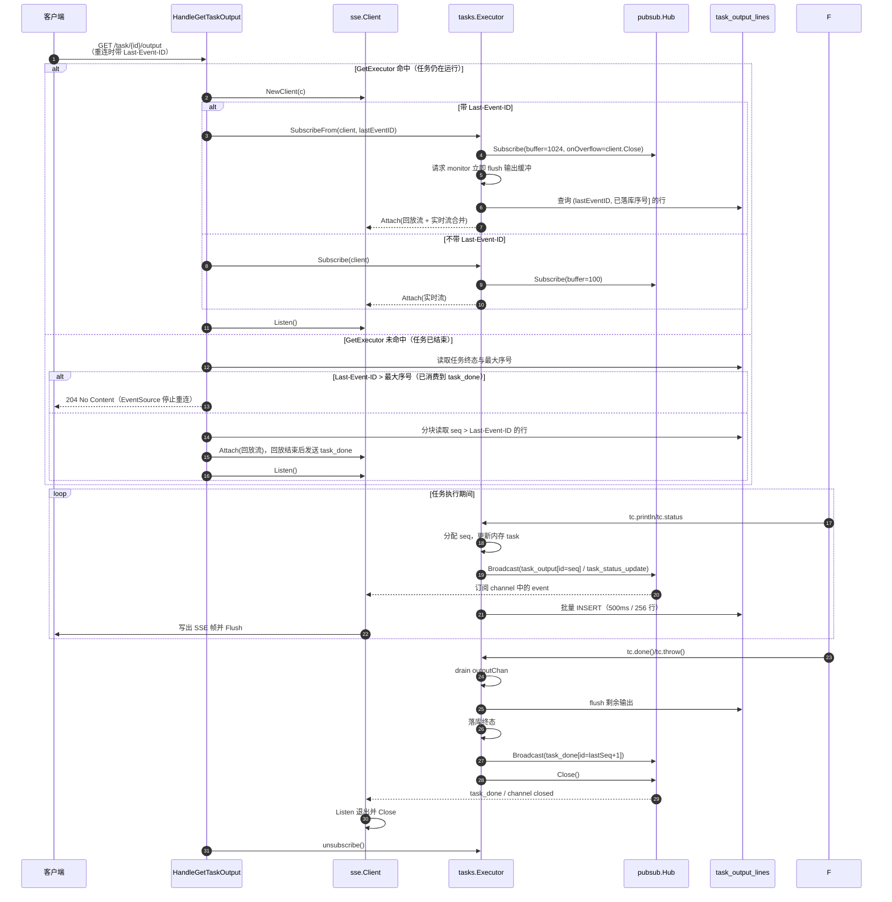

# SSE 生命周期

下面这张时序图整理了“客户端请求任务 SSE 输出”从建立连接到 `task_done` 后主动关闭的完整生命周期，包括 `Last-Event-ID` 重连回放。

## 说明

- `HandleGetTaskOutput` 负责把 HTTP 请求升级为 SSE 连接。任务仍在运行时把客户端注册到执行器；任务已结束时直接从 `task_output_lines` 回放。
- 输出按行存放在 `task_output_lines`（`task_id`, `seq` 唯一），不再全量更新 `tasks` 表。旧的 `tasks.output` 列仅为 schema 兼容保留，`store.UpdateTask` 只更新可变字段；`Task.Output` 由 `store.GetTask` 拼接返回。
- `tasks.Executor` 在 `monitor()` 中维护任务状态：输出先进入 `TaskContext.outputChan`（有缓冲），分配单调递增的 `seq` 后立即广播，并按批写库。
- `task_output` 事件带有 `id: <seq>`；`task_done` 的 ID 是 `lastSeq+1`。
- 重连时客户端由浏览器自动携带 `Last-Event-ID`。执行器先订阅、再请求 monitor 把当前缓冲落库，因此“订阅前已广播”的行一定在数据库中，“订阅后”的行一定在实时通道中，两段拼接不会丢失或重复。
- 回放与实时事件通过 `relayEvents` 合并：回放完成前缓存实时事件，避免历史与实时交错；序号不大于回放上限的实时输出被丢弃。
- `pubsub.Hub` 负责扇出：每个订阅者有自己的缓冲 channel。普通任务流使用 100 的缓冲，慢订阅者会被移除；带回放的订阅使用 1024 的缓冲。
- `sse.Client.Listen()` 负责把事件真正写到 HTTP 响应里；它不解释业务事件名，事件源 channel 被关闭（`Hub.Close` 或回放结束）或连接断开时退出。
- 任务结束时先广播 `task_done`（只是最后一个普通事件），随后关闭 Hub；订阅 channel 关闭是客户端退出的唯一信号。
