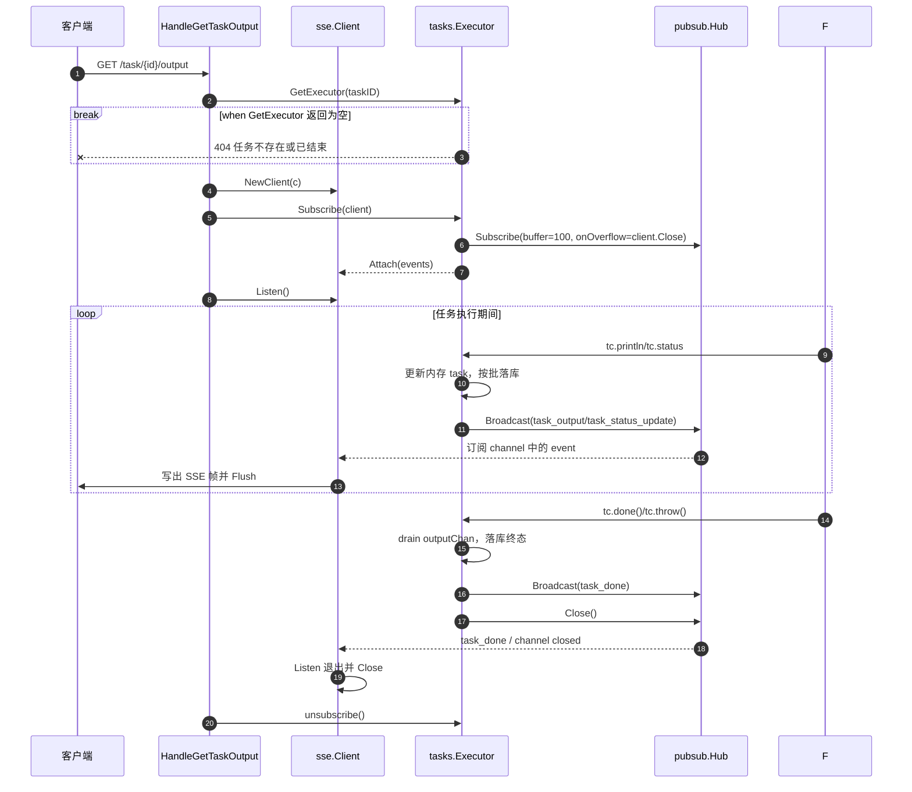

# SSE 生命周期

下面这张时序图整理了“客户端请求任务 SSE 输出”从建立连接到 `task_done` 后主动关闭的完整生命周期。

## 说明

- `HandleGetTaskOutput` 负责把 HTTP 请求升级为 SSE 连接，并把客户端注册到当前任务的执行器上。
- `tasks.Executor` 在 `monitor()` 中维护任务状态：输出先进入 `TaskContext.outputChan`（有缓冲），再由 monitor 广播并按批写库。
- `pubsub.Hub` 负责扇出：每个订阅者有自己的缓冲 channel。任务链路使用 100 的缓冲，慢订阅者会被移除；状态链路使用 1 的缓冲，满时丢弃中间值。
- `sse.Client.Listen()` 负责把事件真正写到 HTTP 响应里；它不解释业务事件名，事件源 channel 被关闭（`Hub.Close`）或连接断开时退出。
- 任务结束时先广播 `task_done`（只是最后一个普通事件），随后关闭 Hub；订阅 channel 关闭是客户端退出的唯一信号。
