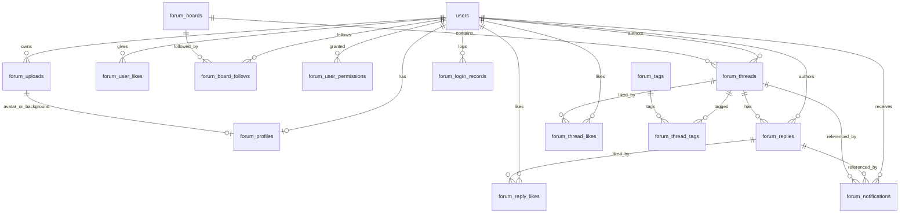

# Moon 项目论坛后端实现方案（站点名默认 Tide）

> 状态：已评审，可开始实施  
> 适用范围：`internal/modules/forum/`、`internal/common` 配置与迁移  
> 目标：在现有 Go 后端上落地一个可运营、可授权、无演示数据依赖的论坛系统；API 契约以本文为准。  
> 实施方式：本文对应后端任务会话；先完成后端、单元测试与 API 级 E2E，再另开前端会话。后端任务不实施任何前端代码。  
> 前台实现见 `moon-front-plan.md`；管理后台前端不在本文范围，后端只提供管理 API。
>
> 建议阅读顺序：0 结论 → 2 技术栈 → 4 数据模型 → 5 权限 → 9 API → 10 关键流程 → 12 配置 → 13 实施阶段。

---

## 0. 结论摘要

1. **不引入新的后端框架**：继续使用 Go + Gin + GORM + MySQL/MariaDB，沿用现有 `h` 响应包装、`scs` session、Atlas/golang-migrate 迁移和模块前缀 `/forum-v1`。
2. **论坛独立存储、独立权限、独立管理 API**：
   - 业务表统一使用 `forum_` 前缀，与 lab 同库不同表。
   - 论坛拥有自己的权限点，并直接把权限节点授予用户，支持全局/板块级范围；共享 `users` 只提供账号与封禁状态。
   - 管理后台前端不在本文范围；后端只提供 `/forum-v1/admin/...` 管理 API。
3. **图片落到本地磁盘**：上传到 `state/forum/uploads/`，由 `GET /forum-v1/files/*key` 只读提供；新增 `forum_uploads` 记录元数据。不引入存储抽象层，直接按本地磁盘实现。
4. **用户资料独立**：新增 `forum_profiles`，只保存昵称、bio、头像、主页背景、头像形状；`users.username` 保持不变，是唯一登录凭据与 @ 标识；昵称可选，未设置时展示 `username`。
5. **通知持久化**：新增 `forum_notifications`，回复/点赞/@ 提及时写入，取消点赞或删除内容时同步清理；已读状态存 `read_at`。
6. **不做业务种子数据**：板块、主题、回复、标签、用户资料全部从空开始，由管理员通过管理 API 创建。系统级权限点目录是代码常量；用户授权由管理 API 直接分配权限节点，不预置角色或授权数据。
7. **富文本 HTML 是唯一正文格式**：服务端必须重新 sanitize，客户端 Markdown 仅作为导入/导出转换；正文内图片必须先上传，禁止 `data:` 图片入库。
8. **回复楼层稳定**：回复创建时分配不可变 `floor`，删除后保留“已删除楼层”占位，不做重新编号，避免引用失效。

### 0.1 需要默认确认的假设

| 假设 | 默认值 | 说明 |
|---|---|---|
| 站点名 | `Tide` | 默认站点名，由 `site_name` 设置控制，后台可修改 |
| 头像形状 | 按用户保存 | 每个用户在 `forum_profiles.avatar_shape` 选择 `circle` / `square`，DTO 按用户返回 |
| 回复删除 | 保留楼层占位 | 楼层号是 `re#楼层` 引用的锚点，删除后不重排，避免历史引用错位 |
| 管理后台前端 | 不在本文范围 | 本文只实现 `/forum-v1/admin/...` 管理 API |
| 权限授予 | 直接授予权限节点 | 管理员在后台按用户勾选权限节点，scope 可全局或指定板块；不存在角色实体 |
| @ 提及 | 基于 `username` | chip 以 `user_id` 指向用户、展示 `@username`；昵称只用于候选搜索；创建/编辑内容时通知被提及者 |
| 举报/审核队列 | v1 不做 | v1 不提供举报/审核队列；表结构可后续扩展 |

### 0.2 评审确认的实施决策

| 事项 | 决策 |
|---|---|
| 新增依赖 | Phase 0 引入 `bluemonday`、`golang.org/x/image`；`x/net`、`x/time` 提升为直接依赖 |
| 权限 enforcer | forum 自持 `sub,dom,perm` 模型与 enforcer，不复用 `common/perm_util` |
| 绑定错误 | 扩展 `common/h`，JSON/query 绑定失败统一映射为 400；lab 与 forum 共用同一响应协议 |
| Cookie Secure | `common/session_util.Manager` 增加 `SetSecure(bool)`，`main` 加载配置后统一设置 |
| 迁移校验 | 使用 `atlas migrate validate --env mysql` |
| 板块 slug | 软删除后 slug 仍占用，同 slug 重建返回 409 |
| 用户资料 | 论坛从不删除 `forum_profiles`，`user_id` 唯一索引安全 |

---

## 1. 背景与约束

### 1.1 现有后端

- 入口：`cmd/aliyunmc/main.go`，同一进程内注册 `lab.Bind` 与 `forum.Bind`。
- 共享层：`internal/common`，提供配置、DB、共享 `User`、session 工厂、Casbin 模型、日志、HTTP 包装。
- forum 目前只有骨架：
  - `internal/modules/forum/forum.go`：`Prefix = "/forum-v1"`，空路由组。
  - `internal/modules/forum/session/session.go`：`forum_session` cookie，Path `/forum-v1`。
  - `internal/modules/forum/perms/perms.go`：当前借用共享 `perm_util` 的 `sub,obj,act` 角色模型，策略为空；实现时替换为 forum 自持的 `sub,dom,perm` enforcer（见 5.4）。
- 数据库：生产 MariaDB 10.11，开发 MySQL；版本化迁移在 `internal/common/migrations/`。
- API 约定：成功 `{"data": ...}`，失败 `{"details": "..."}`；路由包装使用 `internal/common/h`。

### 1.2 前端实现

论坛前台的页面、组件、数据层与交互实现见 `moon-front-plan.md`；本文只约束后端 API 契约与数据语义。

### 1.3 已确认的产品决策

- 图片：本地磁盘 + Go 静态路由。
- 用户资料：独立 `forum_profiles`，登录只用 `username`；昵称可选、可重复、可修改，展示时回退到 `username`。
- 范围：完整前台功能 + 细粒度权限 + 独立管理 API；不做业务种子数据。
- 通知：持久化 `forum_notifications`，类型包含回复、点赞与 @ 提及。
- 提及：以唯一 `username` 作为 @ 标识和展示名；创建/编辑内容时向新增被提及用户发送通知。
- 权限：论坛独立权限点 + 按用户直接授权 + 板块级范围。
- 管理 API 首版：板块管理、内容管理、用户与权限管理、运营与站点设置全部覆盖。

### 1.4 非目标（v1）

- 论坛注册、找回密码、邮箱验证（统一由 lab 账号体系负责）。
- 实时 SSE 通知（先用轮询；后续可接 `common/pubsub`）。
- 全文检索引擎（MySQL `LIKE/INSTR` 起步，后续可接 Meilisearch）。
- 私信、举报/审核队列、主题浏览计数、收藏夹、关注用户动态。
- 多实例部署下的分布式限流（先用进程内限流）。
- 对象存储/CDN 图片存储（v1 只做本地磁盘）。

---

## 2. 技术栈选型

| 领域 | 选型 | 理由 |
|---|---|---|
| 语言/HTTP | Go 1.25 + Gin | 与现有后端一致 |
| ORM/DB | GORM + MySQL/MariaDB | 与 lab 同库；生产 MariaDB 10.11 |
| 迁移 | Atlas diff + golang-migrate | 沿用 `docs/DB.md` 流程 |
| 会话 | `alexedwards/scs` + `gormstore` | 论坛与 lab 已有独立 cookie 约定 |
| 权限 | Casbin v2 + `forum_user_permissions` | 权限节点直接授予用户；板块级 domain；所有权在 handler/service 校验 |
| HTML 解析 | `golang.org/x/net/html` | 纯文本提取、标题/标签/引用解析 |
| HTML sanitize | `github.com/microcosm-cc/bluemonday` | 白名单策略成熟，支持属性/样式/URL 协议限制 |
| 图片解码 | 标准库 `image/*` + `golang.org/x/image/webp` | 校验尺寸、剥离元数据、限制像素 |
| 上传存储 | 本地磁盘 + Go 静态路由 | 无云成本；实现简单，不预留存储抽象 |
| 搜索 | MySQL `INSTR`/`LIKE` + `content_text` | 中文分词在 MariaDB 上不可靠；小规模论坛足够 |
| 通知 | 持久化表 + 轮询未读数 | 简单、准确；后续可加 SSE |
| 测试 | Go `testing` + 现有 `testutil.OpenMySQLTestDB` | 后端单元/集成测试 |

> **依赖变更**：`github.com/microcosm-cc/bluemonday` 与 `golang.org/x/image` 当前不在 `go.mod`，Phase 0 引入；`golang.org/x/net`、`golang.org/x/time` 目前是间接依赖，实际使用后提升为直接依赖。

### 2.1 关键选型说明

- **搜索不用 MySQL FULLTEXT**：MariaDB 10.11 对中文分词支持有限，`ngram` 兼容性需要在目标版本验证；v1 用 `INSTR` 做子串匹配，配合分页和索引，规模可控。后续可把搜索抽象成 `SearchService`，替换为 Meilisearch。
- **图片不存 data URL**：正文 HTML 体积会失控，且无法做缓存/清理/审核。正文图片只接受已上传的 `/forum-v1/files/...` URL；服务端拒绝 `data:` 图片。
- **管理后台独立 session**：管理员与普通论坛用户可能在不同标签页登录不同账号。使用 `forum_admin_session`，Path `/forum-v1/admin`，避免覆盖 `forum_session`。
- **楼层不重排**：引用 `re#3` 指向的是楼层号，重排会让历史引用错位。删除保留占位。
- **头像形状按用户**：`forum_profiles.avatar_shape` 保存每个用户的选择，DTO 按用户返回 `avatarShape`。

---

## 3. 总体架构

### 3.1 模块边界

```
cmd/aliyunmc/main.go
  ├─ common: config / store / session_util / perm_util / h / log_util / paths
  ├─ lab.Bind(engine)                 # /lab-v1
  └─ forum.Bind(engine)               # /forum-v1
       ├─ /auth/*                     # 论坛登录态
       ├─ /boards/* /threads/* ...    # 论坛前台 API
       ├─ /files/*                    # 本地图片静态服务
       └─ /admin/*                    # 管理后台 API（独立 admin session）
```

依赖方向保持 `modules/* → common`；`common` 不 import forum。

### 3.2 目录结构

```
internal/modules/forum/
  forum.go                     # Prefix、MustInitialize、Bind
  models/                      # GORM 实体 + Entities()
  dto/                         # API DTO 与组装函数
  content/                     # sanitize、纯文本、标签、楼层引用与提及解析
  uploads/                     # 文件存储、图片校验、URL/静态服务
  perms/                       # 权限点目录、用户权限节点、forum 自持 Casbin 模型（model.conf）与同步
  session/                     # forum_session + forum_admin_session
  mid/                         # Auth / OptionalAuth / AdminAuth / RequirePermission / RateLimit
  dao/                         # 数据访问（按聚合拆文件）
  service/                     # 业务事务：发帖、回复、点赞、通知、审核、权限授予、设置
  routes/
    auth_routes/
    board_routes/
    thread_routes/
    reply_routes/
    user_routes/
    search_routes/
    tag_routes/
    notification_routes/
    upload_routes/
    site_routes/
    admin_routes/
      auth_routes/
      board_routes/
      content_routes/
      user_routes/
      permission_routes/
      setting_routes/
      upload_routes/
      stats_routes/
      audit_routes/
```

### 3.3 请求链路

```
Gin engine
  ├─ labsession.Manager.LoadAndSave
  ├─ forumsession.Manager.LoadAndSave
  ├─ forumsession.AdminManager.LoadAndSave
  ├─ forum.Bind
  │    ├─ public routes: OptionalAuth(forum session) → handler
  │    ├─ user routes:   Auth(forum session) → RequirePermission → handler
  │    ├─ admin routes:  AdminAuth(admin session) → RequirePermission → handler
  │    └─ files:         static handler（无 session）
  └─ h.G / h.B / h.Q 统一响应
```

### 3.4 分层职责

- **routes**：参数绑定、HTTP 状态、调用 service；不写业务事务。
- **service**：权限判断后的业务规则、事务边界、通知/审计副作用。
- **dao**：只做查询与写入，不处理 HTTP。
- **content**：纯函数，便于单测；服务端唯一可信的 HTML 处理入口。
- **perms**：权限点常量、用户权限节点、forum 自持 Casbin 模型与同步（不复用 `common/perm_util` 的角色模型）；不直接处理 HTTP。
- **dto**：把模型 + 关联数据 + viewer 状态组装成稳定 JSON 契约。

---

## 4. 数据模型

### 4.1 设计原则

- 所有论坛业务表使用 `forum_` 前缀，避免与 lab 现有表冲突。
- 共享 `users` 不新增论坛专属列；论坛资料放 `forum_profiles`。
- 主键使用 `uint` 自增；对外 JSON 使用数字 ID（用户、主题、回复、板块、通知等）。
- 软删除只用于需要恢复的内容（板块、主题、回复、上传）；点赞、关注、通知、权限授予使用硬删除。
- 计数（回复数、点赞数、获客数、关注数）默认由聚合查询派生，不维护缓存列，避免漂移；列表接口用批量聚合避免 N+1。
- 时间统一存 UTC，JSON 输出 RFC3339。

### 4.2 ER 图



> 权限直接授予用户：`forum_user_permissions` 保存 `(user, permission_code, board scope)`，不存在角色表。

### 4.3 表清单

| 表 | 作用 | 软删除 |
|---|---|---|
| `forum_profiles` | 论坛用户资料 | 否（不提供删除） |
| `forum_boards` | 板块 | 是 |
| `forum_threads` | 主题 | 是 |
| `forum_replies` | 跟帖 | 是 |
| `forum_tags` | 标签 | 否 |
| `forum_thread_tags` | 主题-标签关联 | 否 |
| `forum_thread_likes` | 主题点赞 | 否 |
| `forum_reply_likes` | 跟帖点赞 | 否 |
| `forum_user_likes` | 用户主页点赞 | 否 |
| `forum_board_follows` | 板块关注 | 否 |
| `forum_notifications` | 通知 | 否 |
| `forum_uploads` | 上传文件元数据 | 是 |
| `forum_user_permissions` | 用户权限节点（全局/板块级） | 否 |
| `forum_settings` | 站点设置键值 | 否 |
| `forum_audit_logs` | 管理操作审计 | 否 |
| `forum_login_records` | 论坛/后台登录记录 | 否 |

### 4.4 表结构

#### forum_profiles

| 字段 | 类型 | 约束/索引 | 说明 |
|---|---|---|---|
| `id` | bigint unsigned | PK | |
| `created_at` / `updated_at` / `deleted_at` | datetime(3) | `deleted_at` index | |
| `user_id` | bigint unsigned | unique, not null | 关联共享 `users.id` |
| `nickname` | varchar(32) | nullable | 可选昵称，可重复、可修改；为空时展示 `users.username` |
| `bio` | varchar(200) | not null default '' | 纯文本简介 |
| `avatar_upload_id` | bigint unsigned | nullable, index | 自定义头像；为空用默认头像 |
| `background_upload_id` | bigint unsigned | nullable, index | 主页背景 |
| `avatar_shape` | varchar(8) | not null default 'circle' | `circle` / `square` |
| `permissions_initialized` | bool | not null default false | 是否已发放首次登录默认权限节点；防止管理员撤销全部授权后又被自动补回 |

约束：

- `username` 由共享 `users` 管理：唯一、不可修改，是登录与 @ 的唯一凭据。
- `nickname` 可选：为空/null 时前台展示 `username`；非空时 1~32 rune，禁止控制字符；允许重复、允许随时修改。
- 修改昵称不做唯一性校验，也不影响登录。
- `bio` 最多 200 rune，纯文本。
- 论坛不删除资料：不提供删除 `forum_profiles` 的操作；封禁/删除账号只影响共享 `users`，资料行保留。`deleted_at` 列保留但不会写入，`user_id` 唯一索引不会与软删除冲突。

#### forum_boards

| 字段 | 类型 | 约束/索引 | 说明 |
|---|---|---|---|
| `id` | bigint unsigned | PK | |
| `created_at` / `updated_at` / `deleted_at` | datetime(3) | | |
| `slug` | varchar(64) | unique, not null | 公共 URL 标识；创建后不可修改 |
| `name` | varchar(64) | not null | |
| `description` | varchar(255) | not null default '' | |
| `icon` | varchar(32) | not null default 'discussion' | `discussion` / `code` / `life` / `feedback` |
| `color` | varchar(7) | not null default '#6366f1' | `^#[0-9a-fA-F]{6}$` |
| `sort_order` | int | not null default 0 | 升序 |
| `enabled` | bool | not null default true | 禁用后前台不可见 |

索引：`(enabled, sort_order)`。

- `slug` 正则 `^[a-z0-9](?:[a-z0-9-]{0,62}[a-z0-9])?$`，保留字：`admin`、`new`、`api`、`files`。
- 删除板块前必须没有未删除主题；否则先禁用或迁移主题。
- 软删除的板块仍占用 `slug`：不允许用同一 slug 重建，返回 409 并提示恢复原板块。

#### forum_threads

| 字段 | 类型 | 约束/索引 | 说明 |
|---|---|---|---|
| `id` | bigint unsigned | PK | |
| `created_at` / `updated_at` / `deleted_at` | datetime(3) | | |
| `board_id` | bigint unsigned | not null, index | |
| `author_id` | bigint unsigned | not null, index | |
| `title` | varchar(160) | not null | 1~120 rune |
| `content_html` | longtext | not null | sanitize 后 HTML |
| `content_text` | mediumtext | not null | 纯文本，用于搜索/摘要 |
| `pinned` | bool | not null default false | |
| `pinned_at` | datetime(3) | nullable | |
| `locked` | bool | not null default false | 锁定后禁止新回复 |
| `last_reply_at` | datetime(3) | nullable, index | 最近回复时间，便于后台排序 |
| `deleted_by` | bigint unsigned | nullable | 删除操作者；用户自删也记录 |

索引：

- `(board_id, pinned, created_at)`
- `(board_id, created_at)`
- `(author_id, created_at)`
- `(pinned, created_at)`
- `(last_reply_at)`

#### forum_replies

| 字段 | 类型 | 约束/索引 | 说明 |
|---|---|---|---|
| `id` | bigint unsigned | PK | |
| `created_at` / `updated_at` / `deleted_at` | datetime(3) | | |
| `thread_id` | bigint unsigned | not null, index | |
| `author_id` | bigint unsigned | not null, index | |
| `floor` | int unsigned | not null | 稳定楼层号，从 1 开始 |
| `content_html` | longtext | not null | |
| `content_text` | mediumtext | not null | |
| `reply_to_floor` | int unsigned | nullable | 正文中第一个有效引用楼层 |
| `reply_to_reply_id` | bigint unsigned | nullable, index | 解析后的目标回复 |
| `deleted_by` | bigint unsigned | nullable | |

约束：

- unique `(thread_id, floor)`。
- 楼层分配在事务内锁 `forum_threads` 行后取 `MAX(floor)+1`，不因删除回退。
- 软删除的回复在主题详情中返回 `deleted: true` 的占位，保留 `floor` 和锚点，正文/作者不公开。

#### forum_tags

| 字段 | 类型 | 约束/索引 | 说明 |
|---|---|---|---|
| `id` | bigint unsigned | PK | |
| `name` | varchar(32) | not null | 首次出现时的大小写形式 |
| `normalized` | varchar(32) | unique, not null | 小写归一化，用于去重/搜索 |
| `created_at` | datetime(3) | not null | |

#### forum_thread_tags

| 字段 | 类型 | 约束/索引 |
|---|---|---|
| `thread_id` | bigint unsigned | PK, FK |
| `tag_id` | bigint unsigned | PK, FK, index |
| `created_at` | datetime(3) | not null |

#### forum_thread_likes

| 字段 | 类型 | 约束/索引 |
|---|---|---|
| `thread_id` | bigint unsigned | PK, FK |
| `user_id` | bigint unsigned | PK, FK, index |
| `created_at` | datetime(3) | not null |

#### forum_reply_likes

| 字段 | 类型 | 约束/索引 |
|---|---|---|
| `reply_id` | bigint unsigned | PK, FK |
| `user_id` | bigint unsigned | PK, FK, index |
| `created_at` | datetime(3) | not null |

#### forum_user_likes

| 字段 | 类型 | 约束/索引 |
|---|---|---|
| `target_user_id` | bigint unsigned | PK, FK, index |
| `liker_id` | bigint unsigned | PK, FK, index |
| `created_at` | datetime(3) | not null |

约束：`target_user_id != liker_id` 在 service 层校验。

#### forum_board_follows

| 字段 | 类型 | 约束/索引 |
|---|---|---|
| `board_id` | bigint unsigned | PK, FK |
| `user_id` | bigint unsigned | PK, FK, index |
| `created_at` | datetime(3) | not null |

#### forum_notifications

| 字段 | 类型 | 约束/索引 | 说明 |
|---|---|---|---|
| `id` | bigint unsigned | PK | |
| `recipient_id` | bigint unsigned | not null, index | 接收者 |
| `actor_id` | bigint unsigned | not null, index | 触发者 |
| `type` | varchar(16) | not null | `reply` / `like_thread` / `like_reply` / `mention` |
| `thread_id` | bigint unsigned | not null, index | |
| `reply_id` | bigint unsigned | not null default 0 | 0 表示无 |
| `excerpt` | varchar(500) | not null default '' | 触发内容摘要，写入时截断 |
| `read_at` | datetime(3) | nullable | 已读时间 |
| `created_at` | datetime(3) | not null | |

索引：

- `(recipient_id, read_at, created_at)`
- `(recipient_id, created_at)`
- unique `(type, actor_id, recipient_id, thread_id, reply_id)`，防止同一触发者对同一接收者和内容重复写入通知。

规则：

- 回复主题：通知主题作者；`actor == recipient` 不通知。
- 点赞主题/回复：通知内容作者；自赞不通知。
- @ 提及：创建主题/回复时通知正文中提及的用户；自提及不通知；同一内容中已被 `reply` 通知覆盖的接收者不再写 `mention`。
- 编辑主题/回复：同步更新相关通知的 `excerpt`；只为新增提及且尚无同内容 `mention` 通知的用户补写通知；移除提及不删除历史通知，避免编辑反复触发提醒。
- 取消点赞：删除对应通知（无论是否已读）。
- 删除主题：删除 `thread_id` 相关通知。
- 删除回复：删除 `reply_id` 相关通知。

#### forum_uploads

| 字段 | 类型 | 约束/索引 | 说明 |
|---|---|---|---|
| `id` | bigint unsigned | PK | |
| `created_at` / `updated_at` / `deleted_at` | datetime(3) | | |
| `owner_id` | bigint unsigned | not null, index | 上传者 |
| `kind` | varchar(16) | not null | `post` / `avatar` / `background` |
| `key` | varchar(255) | unique, not null | 相对路径，如 `2026/11/<random>.webp` |
| `original_name` | varchar(255) | not null default '' | |
| `mime` | varchar(64) | not null | `image/jpeg` / `image/png` / `image/webp` |
| `size_bytes` | bigint | not null | |
| `width` | int | not null | |
| `height` | int | not null | |
| `sha256` | char(64) | not null, index | 去重/审计 |

#### forum_user_permissions

| 字段 | 类型 | 约束/索引 | 说明 |
|---|---|---|---|
| `id` | bigint unsigned | PK | |
| `user_id` | bigint unsigned | not null, index | 被授权用户 |
| `permission_code` | varchar(128) | not null, index | 权限点 code |
| `scope_board_id` | bigint unsigned | not null default 0 | 0 = 全局；非 0 = 仅该板块 |
| `granted_by` | bigint unsigned | not null | 操作者；0 表示系统默认授予 |
| `created_at` | datetime(3) | not null | |

unique `(user_id, permission_code, scope_board_id)`。

- 授权是扁平的权限节点记录，不存在角色表或角色-权限映射。
- `permission_code` 必须在代码目录中；目录删除某权限点后，历史记录保留但不再参与判断。
- 撤销授权直接删除记录。
- 板块范围授权只影响该板块内的权限判断；全局授权对所有板块生效。

#### forum_settings

| 字段 | 类型 | 约束/索引 | 说明 |
|---|---|---|---|
| `key` | varchar(64) | PK | 只允许代码中登记的键 |
| `value` | text | not null | 字符串存储，按类型解析 |
| `updated_by` | bigint unsigned | not null | |
| `updated_at` | datetime(3) | not null | |

默认值在代码中，数据库没有行时返回默认值；不做设置种子。

#### forum_audit_logs

| 字段 | 类型 | 约束/索引 | 说明 |
|---|---|---|---|
| `id` | bigint unsigned | PK | |
| `actor_id` | bigint unsigned | not null, index | |
| `action` | varchar(64) | not null, index | 如 `thread.pin` |
| `target_type` | varchar(32) | not null | `board` / `thread` / `reply` / `user` / `permission` / `setting` / `upload` |
| `target_id` | bigint unsigned | not null default 0 | |
| `detail` | json/text | not null | 变更前后、原因；不存正文 |
| `ip` | varchar(45) | not null default '' | |
| `user_agent` | varchar(255) | not null default '' | |
| `created_at` | datetime(3) | not null, index | |

#### forum_login_records

| 字段 | 类型 | 约束/索引 | 说明 |
|---|---|---|---|
| `id` | bigint unsigned | PK | |
| `user_id` | bigint unsigned | not null, index | |
| `channel` | varchar(16) | not null | `forum` / `admin` |
| `ip` | varchar(45) | not null default '' | |
| `user_agent` | varchar(255) | not null default '' | |
| `created_at` | datetime(3) | not null, index | |

### 4.5 关键不变量

1. **一个用户一份论坛资料**：`forum_profiles.user_id` 唯一。
2. **username 唯一且不可变**：由共享 `users` 保证，是登录与 @ 凭据；`forum_profiles.nickname` 不唯一、可修改。
3. **板块 slug 不可变**：创建后不允许修改，避免外链失效。
4. **楼层唯一且稳定**：`(thread_id, floor)` 唯一；删除不重排。
5. **主题必须属于一个启用板块**才能被公开读取/发帖。
6. **点赞关系唯一**：复合主键保证；点赞/取消使用幂等 PUT/DELETE。
7. **通知去重**：`(type, actor_id, recipient_id, thread_id, reply_id)` 唯一。
8. **上传 key 不可猜且唯一**：随机 key，不用原始文件名做路径。
9. **软删除内容默认不出现在公开查询**；后台可带 `status=deleted/all` 查询。
10. **计数不落列**：回复数、点赞数、获客数、关注数通过聚合查询；避免写路径维护多个计数器。
11. **权限节点唯一**：`(user_id, permission_code, scope_board_id)` 唯一；同一权限点可同时存在全局与板块级授权，互不覆盖。

### 4.6 删除与恢复语义

| 对象 | 用户删除 | 管理删除 | 恢复 |
|---|---|---|---|
| 主题 | 软删除；前台 404；通知清理 | 软删除；审计 | 后台恢复；不自动恢复跟帖 |
| 跟帖 | 软删除；楼层占位 | 软删除；审计 | 后台恢复 |
| 板块 | 不允许 | 软删除；要求无主题 | 后台恢复 |
| 上传 | 不允许 | 硬删除文件 + 软删除记录 | 不恢复 |
| 权限授予 | 不允许 | 删除记录；写审计 | 不恢复 |
| 通知 | 已读/删除 | 不提供 | 不恢复 |

### 4.7 索引与查询策略

- 主题列表：`(board_id, pinned, created_at)` 覆盖板块流；`(created_at)` 覆盖首页。
- 回复：`(thread_id, floor)` 覆盖楼层顺序；`(author_id, created_at)` 覆盖用户回复列表。
- 通知：`(recipient_id, read_at, created_at)` 覆盖未读筛选；`(recipient_id, created_at)` 覆盖全部。
- 点赞：复合主键覆盖存在性判断；`user_id` 索引覆盖“我赞过的”。
- 计数：对当前页 ID 批量 `GROUP BY`，不逐条查询。
- 搜索：`INSTR(title/content_text, ?)`；小规模可接受。后续把 `SearchService` 替换为全文索引/外部引擎。

---

## 5. 权限模型

### 5.1 设计目标

- 论坛与 lab 的权限体系独立；共享 `users.role` 只作为超级用户的“破窗”兜底。
- **权限点直接授予用户，不使用角色作为授权单位**。权限点由代码定义，管理员在后台按用户勾选。
- 一个用户可以同时拥有多个权限节点；同一权限节点可以授予全局范围，也可以只授予某个板块。
- 所有权（作者才能改/删自己的内容）仍在 service 层校验；Casbin 只做权限节点级判断。
- 防止管理员把自己锁死：超级用户破窗 + 最后一个全局管理员保护。

### 5.2 权限点目录

> 权限点是代码常量，定义在 `forum/perms/catalog.go`。下表是 v1 全集。`scope` 为 `global` 的权限只能在全局域判断；`board` 表示可按板块授予；`self` 表示普通自助权限，默认授予新用户。

| 权限点 | 分组 | scope | 说明 |
|---|---|---|---|
| `thread.create` | 内容 | self | 发主题 |
| `thread.update_own` | 内容 | self | 编辑自己的主题 |
| `thread.delete_own` | 内容 | self | 删除自己的主题 |
| `reply.create` | 内容 | self | 发跟帖 |
| `reply.update_own` | 内容 | self | 编辑自己的跟帖 |
| `reply.delete_own` | 内容 | self | 删除自己的跟帖 |
| `like.create` | 内容 | self | 点赞主题/回复/用户 |
| `board.follow` | 内容 | self | 关注板块 |
| `profile.update_own` | 用户 | self | 修改自己的资料/头像/背景 |
| `notification.read_own` | 用户 | self | 读取/标记自己的通知 |
| `upload.create` | 内容 | self | 上传图片 |
| `thread.pin` | 审核 | board | 置顶/取消置顶 |
| `thread.lock` | 审核 | board | 锁定/解锁 |
| `thread.move` | 审核 | board | 移动主题到其他板块 |
| `thread.update_any` | 审核 | board | 编辑任意主题 |
| `thread.delete_any` | 审核 | board | 删除任意主题 |
| `reply.update_any` | 审核 | board | 编辑任意跟帖 |
| `reply.delete_any` | 审核 | board | 删除任意跟帖 |
| `content.restore` | 审核 | board | 恢复已删除内容 |
| `content.view_admin` | 审核 | board | 访问后台内容列表 |
| `board.create` | 板块 | global | 创建板块 |
| `board.update` | 板块 | board | 修改板块设置 |
| `board.delete` | 板块 | global | 删除板块 |
| `board.reorder` | 板块 | global | 板块排序 |
| `user.list` | 用户 | global | 查看用户列表/详情 |
| `user.manage` | 用户 | global | 修改用户资料 |
| `user.ban` | 用户 | global | 封禁/解封 |
| `permission.manage` | 权限 | global | 授予/撤销用户的权限节点 |
| `permission.view` | 权限 | global | 查看权限点目录与用户授权 |
| `settings.manage` | 运营 | global | 站点设置 |
| `upload.manage` | 运营 | global | 上传文件管理 |
| `stats.view` | 运营 | global | 数据看板 |
| `audit.view` | 运营 | global | 审计日志 |
| `admin.access` | 后台 | board | 登录管理后台 |

> `admin.access` 允许按板块授予：获得板块级 `admin.access` 的用户可以登录后台，但只看到自己被授权的板块内容。

### 5.3 默认授权与推荐组合

- 新用户首次登录创建 `forum_profiles` 时，若 `permissions_initialized=false` 且该用户没有任何权限记录，授予以下默认自助权限节点（全局）并置 `permissions_initialized=true`：
  - `thread.create`
  - `thread.update_own`
  - `thread.delete_own`
  - `reply.create`
  - `reply.update_own`
  - `reply.delete_own`
  - `like.create`
  - `board.follow`
  - `profile.update_own`
  - `notification.read_own`
  - `upload.create`
- 默认授权是实际的权限节点记录，不是角色；管理员可以逐条撤销。即使撤销全部授权，也不会在下次登录时自动补回。
- 不存在角色表，也不存在“分配角色”操作。以下是常见授权组合，仅供后台批量勾选参考：

| 组合 | 权限节点 |
|---|---|
| 基础组合 | 上述默认自助权限节点 |
| 板块审核组合（授予某板块） | `admin.access`、`content.view_admin`、`thread.pin/lock/move/update_any/delete_any`、`reply.update_any/delete_any`、`content.restore`，scope = 指定板块 |
| 全量组合（全局） | 全部权限点，scope = 全局 |
| 权限管理组合 | `admin.access`、`user.list`、`permission.view`、`permission.manage`，scope = 全局 |

- `admin.access` 可按板块授予；获得板块级 `admin.access` 的用户可以登录后台，只看到授权板块。
- 共享 `users.role == superuser` 的用户始终拥有全部论坛权限（破窗），不需要任何权限记录。
- 共享 `users.role == operator` 不自动获得论坛权限；需要显式授予权限节点。

### 5.4 Casbin 模型

论坛使用独立的权限节点模型 `internal/modules/forum/perms/model.conf`：

```ini
[request_definition]
r = sub, dom, perm

[policy_definition]
p = sub, dom, perm

[policy_effect]
e = some(where (p.eft == allow))

[matchers]
m = r.sub == p.sub && (p.dom == "*" || p.dom == r.dom) && r.perm == p.perm
```

- 该 enforcer 由 `forum/perms` 自持：直接用 `casbin.NewEnforcer` + forum 自己的 `model.conf` 构建，策略来自 `forum_user_permissions`；**不复用** `common/perm_util.Enforcer` 的 `sub,obj,act` 角色模型。

约定：

- `sub`：`user:<id>`
- `dom`：`*` 表示全局；`board:<id>` 表示板块域
- `perm`：权限点 code
- 策略：`p, user:<id>, *, <permission_code>`（全局）或 `p, user:<id>, board:<id>, <permission_code>`（板块级）

判断：

```go
Allow(userID uint, scope string, permission string) (bool, error)
```

- 全局请求 `scope="*"`：只有全局授权生效。
- 板块请求 `scope="board:<id>"`：全局授权与该板块授权同时生效。
- 共享超级用户：直接返回 true。

### 5.5 权限授予同步

- 启动时 `perms.MustInitialize()`：
  1. 从 `forum_user_permissions` 读取全部用户权限节点。
  2. 生成 Casbin policy 字符串，由 forum 自持的 `sub,dom,perm` enforcer 构建（不使用 `common/perm_util`）。
  3. 校验权限点 code 是否仍存在于代码目录；未知权限点记录 warning，不参与判断。
- 授权变更时，在事务提交后调用 `perms.Reload()`；使用 `sync.RWMutex` 原子替换 enforcer。
- 单实例下内存 enforcer 足够；多实例部署时需改为数据库轮询/Redis 广播（非 v1）。

### 5.6 权限校验位置

| 校验类型 | 位置 | 例子 |
|---|---|---|
| 是否登录 | `mid.Auth` / `mid.AdminAuth` | 发帖、点赞、后台 |
| 是否拥有权限节点 | `mid.RequirePermission` 或 service `authz.Allow` | `thread.create` |
| 是否拥有板块级权限 | service 加载资源后 `authz.Allow(scope=board:id)` | 板块级审核用户删除主题 |
| 是否作者本人 | service 所有权检查 | `thread.update_own` |
| 是否封禁 | `mid.Auth` 每次请求检查 `users.banned` | 登录/发帖/后台 |

所有权判断示例：

```go
canAny := authz.Allow(user, "board:"+boardID, "thread.update_any")
isAuthor := thread.AuthorID == user.ID
canOwn := authz.Allow(user, "*", "thread.update_own")
if !canAny && !(isAuthor && canOwn) {
    return ErrForbidden
}
```

### 5.7 管理后台访问

- 管理后台登录成功后，要求用户至少拥有一个 `admin.access`（全局或任一板块）。
- `GET /forum-v1/admin/auth/me` 返回：
  ```json
  {
    "user": { "...": "..." },
    "isSuperuser": false,
    "globalPermissions": ["admin.access", "content.view_admin", "..."],
    "boardPermissions": { "1": ["admin.access", "content.view_admin", "thread.pin"] }
  }
  ```
- 板块级管理员只能看到授权板块的内容；列表接口按可访问板块过滤。

### 5.8 防锁死与防提权

- 共享超级用户始终可进入后台并拥有全部权限。
- 不允许封禁自己。
- 不允许撤销自己最后一个全局 `admin.access` / `permission.manage`（如果系统中没有其他非超级用户拥有该权限）。
- 授予/撤销权限时，操作者只能改动自己已经拥有的权限节点（全局或目标板块），超级用户除外；既不能授予也不能撤销超出自身范围的权限，避免低权限管理员提权或破坏他人授权。
- 因此“权限管理员”是受限委派角色：它只能管理自己持有的节点；需要管理全部节点时，由超级用户操作或给其授予对应节点。
- 权限点目录中的 code 不能被后台新建或改写；新增权限点必须改代码并发布。
- 所有权限授予、封禁、设置变更写审计日志。

---

## 6. 认证与会话

### 6.1 两套独立 session

| 用途 | cookie 名 | Path | Manager |
|---|---|---|---|
| 论坛前台 | `forum_session` | `/forum-v1` | `forum/session.Manager` |
| 管理后台 | `forum_admin_session` | `/forum-v1/admin` | `forum/session.AdminManager` |

- 两套 session 都存 `user_id`、`username`，共用同一个 `gormstore`。
- 在 `cmd/aliyunmc/main.go` 的 `session_util.InitStore` 中同时注册两个 manager。
- 中间件顺序：lab manager → forum manager → admin manager。每个 manager 只读取自己名字的 cookie。
- 管理员与论坛用户可在同一浏览器分别登录不同账号，互不覆盖。

### 6.2 登录

`POST /forum-v1/auth/login`

```json
{ "username": "DuskWalker", "password": "***", "remember": true }
```

- `username` 直接按共享 `users.username` 查；大小写不敏感（MySQL collation）。昵称不能用于登录。
- 拒绝已删除/已封禁用户。
- bcrypt 校验；失败统一返回 401 “账号或密码错误”，不区分用户是否存在。
- 成功：
  1. 确保 `forum_profiles` 存在；不存在则创建（`nickname=NULL`）。
  2. 如果资料 `permissions_initialized=false` 且用户没有任何权限记录，授予 5.3 的默认自助权限节点；无论如何都置 `permissions_initialized=true`。
  3. 写入 `forum_login_records(channel=forum)`。
  4. 设置 `forum_session`；`remember=true` 时 deadline 7 天，否则默认 1 小时。
  5. 返回 `UserDTO` + 权限。
- 登录失败写日志（不含密码），按 IP + username 限流。

`POST /forum-v1/admin/auth/login`

- 使用 `forum_admin_session`。
- 校验账号密码后，检查 `admin.access`（全局或板块）；没有则 403 “无管理权限”。
- 写入 `forum_login_records(channel=admin)`。
- `remember=true` 时 deadline 12 小时，否则 1 小时。

### 6.3 登出与当前用户

- `POST /forum-v1/auth/logout`：清除 forum session。
- `POST /forum-v1/admin/auth/logout`：清除 admin session。
- `GET /forum-v1/auth/me`：
  - 无 session：200 `{data: {user: null, ...}}`，方便前台渲染游客态。
  - 有 session 但用户已删除/封禁：清 session，返回 `user: null`。
  - 正常：返回 `user`、`globalPermissions`、`boardPermissions`。
- `GET /forum-v1/admin/auth/me`：
  - 无有效 admin session：401。
  - 有 session 但失去 `admin.access`：403。
  - 返回同上，另带 `isSuperuser`。

### 6.4 封禁

- 封禁直接修改共享 `users.banned`。
- 论坛 `mid.Auth` 和 `mid.AdminAuth` 每次请求都检查 `banned`，封禁立即生效。
- 封禁不删除内容；后台可继续查看/处理。
- 解封后恢复登录。

### 6.5 CORS / CSRF / Cookie

- 复用 `[base.cors]`；管理后台 origin 必须加入 `allow_origins`，`allow_credentials=true`。
- Cookie `HttpOnly`、`SameSite=Lax`；生产启用 TLS 时设置 `Secure=true`。
  - 当前 `session_util.New` 硬编码 `Secure=false`；在 `common/session_util.Manager` 增加 `SetSecure(bool)`，`main.go` 加载配置后对 lab、forum、forum admin 三个 manager 统一调用。
- 若管理后台与 API 不同站点（不是同一主域的子域），需要 `SameSite=None; Secure`；方案默认同主域部署。
- 管理后台写操作校验 `Origin`：请求带 `Origin` 且不在允许列表时返回 403；未带 `Origin`（curl/代理）不强制。
- 论坛前台写操作依赖 SameSite=Lax + CORS 允许列表。

### 6.6 限流

进程内限流，使用 `golang.org/x/time/rate` + `ttlcache`（已在 go.mod）：

| 场景 | 限制 |
|---|---|
| 登录 | 5 次/分钟/IP + username |
| 发主题 | 10 次/分钟/用户 |
| 发跟帖 | 20 次/分钟/用户 |
| 上传 | 20 次/分钟/用户 |
| 点赞/关注 | 60 次/分钟/用户 |
| 提及候选搜索 | 60 次/分钟/用户 |
| 后台写操作 | 60 次/分钟/用户 |

超限返回 429。单实例有效；多实例需 Redis/DB 限流（非 v1）。

---

## 7. 内容处理管线

服务端是正文的唯一可信入口。所有主题/跟帖写入都走同一管线：

```
原始 HTML
  → 大小/图片数量/标题校验
  → 拒绝 data: 图片与不允许的标签
  → bluemonday sanitize（白名单）
  → 纯文本提取（content_text）
  → 标签提取（forum_tags）
  → 楼层引用解析（仅跟帖）
  → 提及解析与规范化
  → 事务写库
```

### 7.1 输入限制

| 项目 | 限制 |
|---|---|
| 主题标题 | 1~120 rune，去首尾空白，禁止控制字符/换行 |
| 主题 HTML | ≤ 128 KiB（配置） |
| 跟帖 HTML | ≤ 64 KiB（配置） |
| 单篇图片数 | ≤ 20 |
| 单篇 @ 提及数 | ≤ 20；超出 400 |
| 图片 URL | 仅 `http(s)://` 或站内 `/forum-v1/files/` |
| 空正文 | 纯文本为空且没有图片/表格 → 400 |

`data:` 图片在 sanitize 前检测并返回 400，提示“请先上传图片”。

### 7.2 Sanitize 白名单

允许标签：

```
p, br, strong, b, em, i, u, s, del, code, pre, blockquote,
ul, ol, li, h1-h6, hr, a, img,
table, thead, tbody, tfoot, tr, th, td, colgroup, col,
div, span
```

允许属性：

| 标签 | 属性 | 约束 |
|---|---|---|
| `a` | `href`, `title` | `http/https/mailto`，站内相对 `/...`；禁止 `javascript:`/`data:` |
| `img` | `src`, `alt`, `width`, `height`, `data-align` | `src` 仅 http(s) 或 `/forum-v1/files/`；宽高为数字；align 为 left/center/right |
| `code` | `class` | 仅 `language-[a-z0-9-]+` |
| `div` | `class` | 仅 `tableWrapper` |
| `span` | `class`, `data-tag-type`, `data-floor`, `data-user-id` | `class` 仅用于样式（`reply-reference` / `mention`）；`data-tag-type` 仅 `reply` / `mention`；`data-floor` / `data-user-id` 为数字；mention 只保留 `data-tag-type` + `data-user-id` + 样式 class |
| `table` | `style` | 仅 `width/min-width: <n>px` |
| `col` | `style` | 仅 `width: <n>px` |
| `th`/`td` | `colspan`, `rowspan`, `colwidth`, `style` | `style` 仅 `text-align: left/center/right` |

禁止：`script`、`style`、`iframe`、`object`、`embed`、`form`、`input`、`button`、`svg`、`video`、`audio`、所有 `on*` 事件、`id`、`srcset`、`ping`、未知 `data-*`。

实现：`content.Sanitize(html string) (string, error)`，使用 bluemonday 自定义 policy；配合单元测试覆盖 Tiptap 实际输出。

### 7.3 纯文本与摘要

- 用 `golang.org/x/net/html` 解析 fragment。
- 跳过 `script/style/template`；块级标签首尾补空格；`br` 补空格；`img` 取 `alt`。
- 连续空白折叠为单空格。
- `content_text` 用于搜索、卡片摘要、通知摘要。
- 摘要函数：截取前 N 个 rune，超出加 `…`；列表卡片 160，通知 160。

### 7.4 标签提取

标签提取规则必须与前台渲染保持一致：

- 正则：`(^|[^\p{L}\p{N}_#])#([\p{L}\p{N}_][\p{L}\p{N}_-]{0,23})`
- 跳过 `code`、`pre`、`a`、`script/style/template`，以及 `data-tag-type` 为 `reply` 或 `mention` 的节点。
- 按文档顺序去重，保留首次出现的大小写。
- 归一化：`strings.ToLower` 存入 `normalized`；DB collation 负责大小写不敏感唯一。
- 主题编辑时事务内重建 `forum_thread_tags`；孤立标签保留，热门标签查询只统计有主题的标签。

### 7.5 楼层引用解析

- 引用 chip 契约为 `<span class="reply-reference" data-tag-type="reply" data-floor="3">#3</span>`；`class` 仅用于样式，服务端以 `data-tag-type="reply"` 识别。
- 服务端从 sanitize 后的 HTML 中按出现顺序提取 `span[data-tag-type="reply"]` 的合法 `data-floor`（≥0 且 ≤ 当前最大楼层）。
- 跟帖的 `reply_to_floor` 取第一个有效值；再解析为同主题内 `floor` 对应的 `reply_to_reply_id`。
- 引用不合法时保留 chip（前台渲染成普通 span），但 `reply_to_floor` 置空。
- 主题帖本身不解析引用。

### 7.6 提及解析与规范化

- 提及 chip 契约为 `<span class="mention" data-tag-type="mention" data-user-id="3">@DuskWalker</span>`；`class` 仅用于样式，服务端以 `data-tag-type="mention"` 识别；chip 文本始终是 `@username`，不使用昵称。
- 服务端在 sanitize 后扫描 `span[data-tag-type="mention"]`：
  - `data-user-id` 必须为数字；保留 `data-tag-type="mention"`、`data-user-id` 与样式 class `mention`，其余属性丢弃。
  - 批量加载用户与 `forum_profiles`，只保留存在、未删除、未封禁且有论坛资料的用户。
  - 有效提及在写入前重建文本为当前 `@username`，避免 chip 文本与目标用户不一致；无效提及降级为纯文本。
  - 同一内容内按用户 ID 去重；数量超过 20 返回 400。
- 解析结果同时产出 `mentionedUserIds`，供通知写入使用。
- 提及不参与标签提取，也不改变楼层引用解析。
- `username` 不可修改，因此已写入的 chip 文本不会失效；修改昵称不影响任何提及。

### 7.7 编辑

- 主题编辑：`title`、`content_html`；先读取旧正文的提及集合，再重跑 sanitize/纯文本/标签/提及；更新 `updated_at`；同步该主题相关通知的 `excerpt`；只为新增提及（新集合减旧集合）补写通知。
- 跟帖编辑：`content_html`；先读取旧正文的提及集合，再重跑 sanitize/纯文本/引用/提及；楼层不变；同步该回复相关通知的 `excerpt`；只为新增提及补写通知。
- 只有作者或被授予 `*_update_any` 权限节点的用户可编辑；锁定不影响作者编辑自己的内容。
- 编辑不改变 `created_at`、`floor`、点赞关系。

### 7.8 删除

- 主题：软删除主题与其下回复；删除 `thread_id` 相关通知；保留点赞/标签/关注关系以便恢复；`deleted_by` 记录操作者。
- 跟帖：软删除；删除 `reply_id` 相关通知；楼层保留为占位。
- 前台主题详情对已删除回复返回 `deleted: true`，`contentHtml=null`、`author=null`，保留 `floor` 和锚点。
- 因此跟帖列表查询需要对 `forum_replies` 使用 `Unscoped()`，再显式过滤「属于当前主题」；已删除回复作为占位返回，已删除主题整体 404。
- 后台可 `status=deleted` 查看并恢复。

---

## 8. 文件上传与存储

### 8.1 存储布局

```
$GO_ALIYUNMC_STATE_DIR/
  state/forum/uploads/
    2026/11/<random>.webp
    2026/11/<random>.png
```

- `paths.RuntimeDir()` 派生默认目录；配置 `forum.upload_dir` 可覆盖。
- 文件 key 形如 `2026/11/<32 hex>.<ext>`；不使用原始文件名。
- 目录 0750，文件 0644；启动时创建并校验可写，失败则 `log_util.Fatal`。

### 8.2 上传接口

`POST /forum-v1/uploads`（multipart/form-data）

| 字段 | 说明 |
|---|---|
| `file` | 图片文件 |
| `kind` | `post` / `avatar` / `background` |

限制：

| kind | 最大字节 | 用途 |
|---|---|---|
| `post` | 10 MiB | 正文图片 |
| `avatar` | 2 MiB | 头像 |
| `background` | 8 MiB | 主页背景 |

校验：

1. `http.MaxBytesReader` 限制请求体。
2. 读取前 512 字节 `http.DetectContentType`，只允许 `image/jpeg`、`image/png`、`image/webp`；拒绝 SVG/GIF。
3. `image.DecodeConfig` 校验宽高 > 0、总像素 ≤ 24MP、单边 ≤ 8192。
4. 重新解码并编码：
   - JPEG → JPEG（质量 85，剥离 EXIF）
   - PNG → PNG（保留透明）
   - WebP → 校验通过后原样保存（Go 标准库无 WebP 编码器；解码验证即可）
5. 计算 sha256，生成随机 key，写临时文件后原子 rename。
6. 写入 `forum_uploads`；DB 失败时删除文件。
7. 返回：
   ```json
   { "data": { "id": 12, "url": "/forum-v1/files/2026/11/ab12.webp", "width": 1280, "height": 720, "mime": "image/webp", "size": 34567 } }
   ```

失败：413（过大）、415（格式不支持）、400（尺寸/像素不合格）。

### 8.3 静态文件服务

`GET /forum-v1/files/*key`

- 只读，无需登录；key 必须匹配 `^\d{4}/\d{2}/[a-f0-9]{32}\.(jpg|png|webp)$`。
- 用 `filepath.Clean` + 前缀校验防止路径穿越；只允许上述扩展名。
- `Content-Type` 取自 `forum_uploads.mime`；`X-Content-Type-Options: nosniff`。
- `Cache-Control: public, max-age=31536000, immutable`（key 随机且不复用）。
- `Content-Disposition: inline`。
- 支持 Range（`http.ServeFile`/`c.File`）。
- Gin 的 `*key` 参数带前导 `/`，服务端需 `TrimPrefix` 后再按 key 正则校验。

### 8.4 头像与主页背景

- 头像与背景分别通过 `kind=avatar`、`kind=background` 上传，再用 `PUT /me/avatar`、`PUT /me/background` 绑定 `uploadId`。
- 未设置头像时，服务端返回默认头像 URL：
  `settings.default_avatar_url_template`（默认 `https://minotar.net/helm/{username}/200.png`）。
- 替换头像/背景后旧文件不立即删除；后台上传管理可清理未被引用的文件。
- 头像形状存 `forum_profiles.avatar_shape`，DTO 按用户返回 `avatarShape`。

### 8.5 上传管理

- `GET /admin/uploads?kind=&ownerId=&page=`：列表、大小、引用状态。
- `DELETE /admin/uploads/:id`：
  - 若被 `forum_profiles.avatar_upload_id/background_upload_id` 引用，或正文 HTML 中出现该 key，返回 409。
  - 否则删除文件与记录，写审计。
- `GET /admin/uploads/stats`：按 kind 统计数量/字节。
- 预留 `POST /admin/uploads/gc`（扫描未引用且超过 N 天的文件）作为后续增强。

---

## 9. API 设计

### 9.1 通用约定

- 前缀：论坛前台 `/forum-v1`，管理后台 `/forum-v1/admin`。
- 成功：`{"data": ...}`；失败：`{"details": "..."}`。
- JSON 字段使用 **camelCase**，与客户端 TypeScript 类型一致；数据库列保持 snake_case。
- ID 使用数字；日期使用 RFC3339 UTC 字符串。
- 分页响应：
  ```json
  { "data": { "items": [], "total": 0, "page": 1, "pageSize": 20 } }
  ```
- 默认分页：前台 20/页，最大 50；后台 20/页，最大 100。
- 空列表返回 `[]`，不返回 `null`。
- 写操作要求 `Content-Type: application/json`（上传除外）。
- 扩展 `common/h`：把 JSON/query 绑定失败统一映射为 400，返回 `{"details": "..."}`；lab 与 forum 共用同一响应协议，行为保持一致，不在 forum 内另建绑定包装。
- 删除接口使用 `DELETE`；批量操作使用 `POST .../batch`。
- 点赞/关注使用幂等的 `PUT`/`DELETE`，不使用 toggle，避免并发状态错乱。
- 公开读接口使用 `OptionalAuth`：登录用户会得到 `likedByMe`、`followingByMe`、`canEdit` 等 viewer 字段；游客得到 false/null。
- 若站点设置 `allow_guest_read=false`，除 `/site` 与 `/auth/*` 外的公开读接口要求登录，游客返回 401。

### 9.2 错误码

| 状态 | 场景 |
|---|---|
| 400 | 参数/正文校验失败、空内容、非法引用 |
| 401 | 未登录、密码错误 |
| 403 | 无权限、作者不匹配、封禁、无管理权限 |
| 404 | 资源不存在/已删除/板块禁用 |
| 409 | slug 冲突、重复删除、板块非空、上传被引用 |
| 413 | 请求体/图片过大 |
| 415 | 图片格式不支持 |
| 429 | 限流 |
| 500 | 未预期错误 |

### 9.3 公开接口

| 方法 | 路径 | 说明 |
|---|---|---|
| `GET` | `/site` | 站点名称、描述、公告、页脚、是否允许游客阅读 |
| `GET` | `/boards` | 启用板块列表 + 主题数 + 关注数 + `followingByMe` |
| `GET` | `/boards/:slug` | 板块详情 |
| `GET` | `/threads?board=<slug>&page=&pageSize=` | 非置顶主题流，按 `created_at DESC` |
| `GET` | `/pinned-threads?board=<slug>` | 置顶主题，按 `pinned_at DESC, created_at DESC` |
| `GET` | `/threads/:id` | 主题详情 |
| `GET` | `/threads/:id/replies?page=&pageSize=` | 跟帖，按 `floor ASC`，含删除占位 |
| `GET` | `/recent-replies?board=<slug>&limit=5` | 最近回复 |
| `GET` | `/users/:id` | 用户主页资料 + 主题/回复/获赞数 |
| `GET` | `/users/:id/threads?page=` | 用户主题 |
| `GET` | `/users/:id/replies?page=` | 用户回复 |
| `GET` | `/search?q=&board=&page=` | 多关键词 AND 搜索 |
| `GET` | `/tags?board=&limit=8` | 热门标签 |
| `GET` | `/files/*key` | 图片文件 |

### 9.4 认证接口

| 方法 | 路径 | 说明 |
|---|---|---|
| `POST` | `/auth/login` | 论坛登录 |
| `POST` | `/auth/logout` | 论坛登出 |
| `GET` | `/auth/me` | 当前用户 + 权限；游客 200 + `user:null` |

### 9.5 用户自助接口

| 方法 | 路径 | 权限 | 说明 |
|---|---|---|---|
| `PATCH` | `/me/profile` | `profile.update_own` | 改 nickname/bio |
| `PUT` | `/me/avatar` | `profile.update_own` | `{uploadId: number|null}` |
| `PUT` | `/me/background` | `profile.update_own` | `{uploadId: number|null}` |
| `PUT` | `/me/avatar-shape` | `profile.update_own` | `{shape: "circle"|"square"}` |
| `GET` | `/users/search?q=&limit=10` | 登录 | 提及候选用户；只返回有论坛资料且未封禁的用户；静态路由先于 `/users/:id` 注册 |
| `PUT` | `/users/:id/like` | `like.create` | 点赞用户；返回 `{liked:true, likeCount}` |
| `DELETE` | `/users/:id/like` | `like.create` | 取消点赞 |

### 9.6 板块与关注

| 方法 | 路径 | 权限 | 说明 |
|---|---|---|---|
| `PUT` | `/boards/:slug/follow` | `board.follow` | 关注 |
| `DELETE` | `/boards/:slug/follow` | `board.follow` | 取消关注 |

返回 `{following, followerCount}`。

### 9.7 主题

| 方法 | 路径 | 权限 | 说明 |
|---|---|---|---|
| `POST` | `/threads` | `thread.create` | `{boardId, title, contentHtml}` |
| `PATCH` | `/threads/:id` | `thread.update_own` 或 `thread.update_any` | `{title?, contentHtml?}` |
| `DELETE` | `/threads/:id?reason=` | `thread.delete_own` 或 `thread.delete_any` | 软删除 |
| `PUT` | `/threads/:id/like` | `like.create` | 点赞 |
| `DELETE` | `/threads/:id/like` | `like.create` | 取消点赞 |
| `POST` | `/threads/:id/pin` | `thread.pin` | `{pinned: boolean}` |
| `POST` | `/threads/:id/lock` | `thread.lock` | `{locked: boolean}` |
| `POST` | `/threads/:id/move` | `thread.move` | `{boardId}` |
| `POST` | `/threads/:id/restore` | `content.restore` | 恢复（后台也可） |

### 9.8 跟帖

| 方法 | 路径 | 权限 | 说明 |
|---|---|---|---|
| `POST` | `/threads/:id/replies` | `reply.create` | `{contentHtml}` |
| `PATCH` | `/replies/:id` | `reply.update_own` 或 `reply.update_any` | `{contentHtml}` |
| `DELETE` | `/replies/:id?reason=` | `reply.delete_own` 或 `reply.delete_any` | 软删除 |
| `PUT` | `/replies/:id/like` | `like.create` | 点赞 |
| `DELETE` | `/replies/:id/like` | `like.create` | 取消点赞 |
| `POST` | `/replies/:id/restore` | `content.restore` | 恢复 |

### 9.9 通知

| 方法 | 路径 | 说明 |
|---|---|---|
| `GET` | `/notifications?filter=all\|unread&page=&pageSize=` | 当前用户通知 |
| `GET` | `/notifications/unread-count` | `{count}`，供轮询 |
| `POST` | `/notifications/read` | `{ids?: number[], all?: boolean}`；返回 `{unreadCount}` |

`type` 取值：`reply` / `like_thread` / `like_reply` / `mention`。`mention` 通知的 `replyId` 为 0（主题提及）或跟帖 ID（跟帖提及），客户端据此切换文案。

用户搜索 `GET /users/search`：

- `q` 长度 1~32，按 `users.username` 与 `forum_profiles.nickname` 做大小写不敏感的子串匹配。
- 只返回有 `forum_profiles`、未封禁、未删除的用户，排除当前用户；最多 10 条。
- 返回 `{"data":{"items":[UserSummary...]}}`，字段只包含提及选择器所需信息。
- 需要登录并按用户限流；不允许游客枚举用户。

### 9.10 上传与搜索

| 方法 | 路径 | 说明 |
|---|---|---|
| `POST` | `/uploads` | multipart；`kind` + `file` |
| `GET` | `/search?q=&board=&page=&pageSize=` | 公开搜索 |

### 9.11 管理后台接口

> 全部要求 `forum_admin_session` + 对应权限。`admin.access` 是登录门槛，不替代具体权限。

#### 后台认证

| 方法 | 路径 | 说明 |
|---|---|---|
| `POST` | `/admin/auth/login` | 后台登录 |
| `POST` | `/admin/auth/logout` | 后台登出 |
| `GET` | `/admin/auth/me` | 当前管理员 + 权限 |

#### 看板与审计

| 方法 | 路径 | 权限 | 说明 |
|---|---|---|---|
| `GET` | `/admin/dashboard?days=7` | `stats.view` | 总量、今日新增、趋势 |
| `GET` | `/admin/audit-logs?actorId=&action=&targetType=&targetId=&from=&to=&page=` | `audit.view` | 审计日志 |

#### 板块管理

| 方法 | 路径 | 权限 | 说明 |
|---|---|---|---|
| `GET` | `/admin/boards?includeDisabled=&includeDeleted=&page=` | `admin.access` | 可访问板块列表 |
| `POST` | `/admin/boards` | `board.create` | 创建 |
| `PATCH` | `/admin/boards/:id` | `board.update` | 名称/描述/图标/颜色/排序/启停 |
| `DELETE` | `/admin/boards/:id` | `board.delete` | 要求无主题 |
| `POST` | `/admin/boards/reorder` | `board.reorder` | `{ids: []}` |
| `POST` | `/admin/boards/:id/restore` | `board.delete` | 恢复 |

#### 内容管理

| 方法 | 路径 | 权限 | 说明 |
|---|---|---|---|
| `GET` | `/admin/threads?boardId=&authorId=&status=active\|deleted\|all&pinned=&locked=&keyword=&page=&pageSize=&sort=` | `content.view_admin` | 主题列表 |
| `GET` | `/admin/threads/:id` | `content.view_admin` | 主题详情（含已删除） |
| `PATCH` | `/admin/threads/:id` | `thread.pin/lock/move` | `{pinned?, locked?, boardId?}` |
| `DELETE` | `/admin/threads/:id?reason=` | `thread.delete_any` | 删除 |
| `POST` | `/admin/threads/:id/restore` | `content.restore` | 恢复 |
| `POST` | `/admin/threads/batch` | 对应权限 | `{ids, action, boardId?, reason?}` |
| `GET` | `/admin/replies?threadId=&authorId=&status=&keyword=&page=` | `content.view_admin` | 跟帖列表 |
| `PATCH` | `/admin/replies/:id` | `reply.update_any` | 编辑正文 |
| `DELETE` | `/admin/replies/:id?reason=` | `reply.delete_any` | 删除 |
| `POST` | `/admin/replies/:id/restore` | `content.restore` | 恢复 |
| `POST` | `/admin/replies/batch` | 对应权限 | `{ids, action, reason?}` |

`batch` 支持的 action：`pin`、`unpin`、`lock`、`unlock`、`delete`、`restore`、`move`。每个 ID 单独校验权限；部分失败时返回 `{succeeded:[], failed:[{id, reason}]}`。

#### 用户与权限管理

> 账号创建、密码修改仍由 lab 负责；论坛后台只管理资料、封禁与权限节点，不创建共享账号。

| 方法 | 路径 | 权限 | 说明 |
|---|---|---|---|
| `GET` | `/admin/users?keyword=&banned=&permission=&page=` | `user.list` | 共享用户 + 论坛资料；`permission` 可按权限点筛选 |
| `GET` | `/admin/users/:id` | `user.list` | 详情、计数、权限节点、最近登录 |
| `PATCH` | `/admin/users/:id/profile` | `user.manage` | nickname/bio |
| `POST` | `/admin/users/:id/ban` | `user.ban` | 不能封禁自己 |
| `POST` | `/admin/users/:id/unban` | `user.ban` | |
| `GET` | `/admin/users/:id/permissions` | `permission.view` 或 `permission.manage` | 用户权限节点（全局 + 板块） |
| `PUT` | `/admin/users/:id/permissions` | `permission.manage` | `{grants:[{permissionCode, boardId?}]}`，替换全部授权 |
| `GET` | `/admin/users/:id/login-records?page=` | `user.list` | 论坛/后台登录记录 |
| `GET` | `/admin/permissions` | `permission.view` | 权限点目录 |
| `GET` | `/admin/permissions/:code/users?boardId=&page=` | `permission.view` | 查看拥有该权限节点的用户 |

`PUT /admin/users/:id/permissions` 语义：

- 用请求中的 `grants` 完整替换该用户的权限节点集合；空数组表示撤销全部非默认授权。
- `boardId` 为空表示全局；非空表示仅该板块。
- 服务端校验：权限点存在、板块存在、去重、操作者对新增和移除的每个权限节点都具备对应权限（超级用户除外）。
- 事务内删除旧记录、写入新记录、写审计，提交后 `perms.Reload()`。
- 若用户还没有 `forum_profiles`，先创建空资料；保存授权时一并置 `permissions_initialized=true`，避免首次登录再补默认权限。
- 不允许通过该接口撤销自己最后一个全局 `admin.access` / `permission.manage`。

#### 设置、上传

| 方法 | 路径 | 权限 | 说明 |
|---|---|---|---|
| `GET` | `/admin/settings` | `settings.manage` | 当前设置（含默认值） |
| `PUT` | `/admin/settings` | `settings.manage` | 部分更新；未知键 400 |
| `GET` | `/admin/uploads?kind=&ownerId=&page=` | `upload.manage` | 上传列表 |
| `GET` | `/admin/uploads/stats` | `upload.manage` | 分类统计 |
| `DELETE` | `/admin/uploads/:id` | `upload.manage` | 未被引用才可删 |

### 9.12 关键 DTO

#### UserSummary

```json
{
  "id": 3,
  "username": "DuskWalker",
  "nickname": "晚风",
  "avatarUrl": "/forum-v1/files/2026/11/ab12.webp",
  "avatarShape": "circle"
}
```

#### UserProfile

```json
{
  "id": 3,
  "username": "DuskWalker",
  "nickname": "晚风",
  "bio": "在 Tide 记录想法。",
  "avatarUrl": "https://minotar.net/helm/DuskWalker/200.png",
  "backgroundUrl": null,
  "avatarShape": "square",
  "joinedAt": "2026-03-12T09:00:00Z",
  "threadCount": 2,
  "replyCount": 8,
  "likeCount": 12,
  "likedByMe": false,
  "isSelf": false
}
```

#### BoardSummary

```json
{
  "id": 1,
  "slug": "general",
  "name": "综合讨论",
  "description": "聊聊任何值得认真讨论的事情。",
  "icon": "discussion",
  "color": "#6366f1",
  "threadCount": 12,
  "followerCount": 30,
  "followingByMe": true
}
```

#### ThreadSummary

```json
{
  "id": 12,
  "board": { "id": 1, "slug": "general", "name": "综合讨论", "icon": "discussion", "color": "#6366f1" },
  "author": { "id": 3, "username": "DuskWalker", "nickname": "晚风", "avatarUrl": "...", "avatarShape": "circle" },
  "title": "Tide 的第一帖",
  "excerpt": "最近把 Tide 的框架搭起来了……",
  "tags": ["初见", "社区"],
  "pinned": true,
  "locked": false,
  "replyCount": 4,
  "likeCount": 7,
  "likedByMe": false,
  "createdAt": "2026-11-16T09:00:00Z",
  "updatedAt": "2026-11-16T10:00:00Z"
}
```

#### ThreadDetail

在 `ThreadSummary` 基础上增加：

```json
{
  "contentHtml": "<p>...</p>",
  "canEdit": true,
  "canDelete": true,
  "canModerate": false
}
```

#### Reply

```json
{
  "id": 31,
  "threadId": 12,
  "floor": 3,
  "author": { "...": "..." },
  "contentHtml": "<p>...</p>",
  "replyToFloor": 1,
  "replyToReplyId": 20,
  "likeCount": 2,
  "likedByMe": true,
  "deleted": false,
  "createdAt": "2026-11-16T09:30:00Z",
  "updatedAt": null,
  "canEdit": false,
  "canDelete": false
}
```

删除占位：

```json
{
  "id": 32,
  "threadId": 12,
  "floor": 4,
  "author": null,
  "contentHtml": null,
  "replyToFloor": null,
  "replyToReplyId": null,
  "likeCount": 0,
  "likedByMe": false,
  "deleted": true,
  "createdAt": "2026-11-16T09:40:00Z",
  "updatedAt": null,
  "canEdit": false,
  "canDelete": false
}
```

#### Notification

```json
{
  "id": 5,
  "type": "reply",
  "actor": { "...": "..." },
  "threadId": 12,
  "threadTitle": "Tide 的第一帖",
  "replyId": 31,
  "excerpt": "希望这里能多一点……",
  "read": false,
  "createdAt": "2026-11-16T09:30:00Z"
}
```

`type` 可为 `reply`、`like_thread`、`like_reply`、`mention`；客户端按 `type` 显示文案，并用 `threadId` / `replyId` 跳转。

#### AdminUser

```json
{
  "id": 3,
  "username": "DuskWalker",
  "nickname": "晚风",
  "bio": "...",
  "avatarUrl": "...",
  "avatarShape": "circle",
  "banned": false,
  "labRole": "",
  "createdAt": "2026-03-12T09:00:00Z",
  "lastForumLoginAt": "2026-11-16T09:00:00Z",
  "lastAdminLoginAt": null,
  "threadCount": 2,
  "replyCount": 8,
  "likeCount": 12,
  "permissions": [
    { "permissionCode": "thread.create", "boardId": null },
    { "permissionCode": "thread.pin", "boardId": 2 }
  ]
}
```

### 9.13 搜索语义

- `q` 按空白拆词，所有词必须命中（AND）。
- 每个词匹配：
  - `forum_threads.title`
  - `forum_threads.content_text`
  - 作者 `users.username` / `forum_profiles.nickname`
  - 板块 `name`
  - 标签 `name`（词以 `#` 开头时只匹配标签）
  - 该主题下未删除回复的 `content_text`
- 使用 `INSTR(LOWER(col), LOWER(?)) > 0` 或依赖 `utf8mb4_general_ci` 的 `INSTR(col, ?) > 0`；中文/英文大小写由 collation 处理。
- 排除软删除主题/回复、禁用板块。
- 结果按 `created_at DESC`；返回主题卡片 DTO。
- 热门标签：`forum_thread_tags JOIN forum_threads JOIN forum_tags`，统计未删除主题，按 count desc、name asc。

---

## 10. 关键流程

### 10.1 首次启动与管理员引导

因为不做业务种子数据，首次部署后的状态是：

1. 数据库新增 `forum_*` 表，全部为空。
2. 代码权限点目录可用，但没有任何用户授权、板块、主题或资料。
3. 共享超级用户（或 `create_user --role superuser` 创建的管理员）登录论坛/后台时拥有全部权限（破窗）。
4. 管理员通过管理 API：
   - 创建至少一个板块。
   - 按需给用户授予权限节点（全局或指定板块）。
   - 设置站点名称、公告、页脚等。
5. 普通用户在 lab 创建账号后，首次登录论坛自动创建资料并获得默认自助权限节点。

> “不做种子数据”指不预置板块、主题、回复、用户资料、标签、授权等业务演示数据；权限点目录属于代码结构，不写数据库。

### 10.2 发主题

1. `mid.Auth` 校验登录与封禁。
2. `RequirePermission("thread.create")`。
3. 限流。
4. 校验 `boardId` 存在、启用、未删除。
5. 校验标题/HTML 大小、图片数量、提及数量；拒绝 `data:` 图片。
6. `content.Sanitize` → `content.PlainText` → `content.ExtractTags` → `content.ResolveMentions`。
7. 事务：
   - 创建 `forum_threads`。
   - upsert `forum_tags`，写 `forum_thread_tags`。
   - 对 `mentionedUserIds` 去重并跳过作者本人，写 `mention` 通知（`reply_id=0`）。
   - 写审计（普通用户发帖可不写；管理代发写）。
8. 返回 `ThreadDetail`。

### 10.3 发跟帖与楼层

1. 校验主题存在、未删除、板块启用、未锁定（管理员也需先解锁）。
2. 校验正文、sanitize、纯文本、标签、提及（跟帖标签只用于搜索，不改变主题标签）。
3. 事务：
   - `SELECT ... FOR UPDATE` 锁定主题行。
   - `floor = COALESCE(MAX(floor),0)+1 FROM forum_replies WHERE thread_id=?`（包含已删除回复）。
   - 解析 `reply_to_floor` / `reply_to_reply_id`。
   - 插入回复；更新主题 `last_reply_at`。
   - 若 `thread.author_id != reply.author_id`，写 `reply` 通知。
   - 对 `mentionedUserIds` 去重并跳过作者本人；已被本条回复 `reply` 通知覆盖的用户不再写 `mention`，其余写 `mention` 通知（`reply_id=回复 ID`）。
4. 返回 `Reply`。
5. 并发两个回复会串行化在主题行锁上，unique `(thread_id, floor)` 兜底。

### 10.4 点赞与通知

以主题点赞为例：

```
PUT /threads/:id/like
  → 校验主题存在/未删除
  → INSERT IGNORE forum_thread_likes(thread_id, user_id)
  → 若插入成功且作者 != 点赞者：
       INSERT ... ON DUPLICATE KEY UPDATE? 
       forum_notifications(type=like_thread, actor, recipient=author, thread, reply=0)
  → 返回 liked=true, likeCount=当前计数

DELETE /threads/:id/like
  → DELETE 点赞关系
  → DELETE 对应通知（type=like_thread, actor, recipient=author, thread, reply=0）
  → 返回 liked=false, likeCount
```

- 跟帖点赞同理，`reply_id` 为跟帖 ID，recipient 为跟帖作者。
- @ 提及通知：`mentionedUserIds` 去重后跳过作者本人；同一内容已向该用户写 `reply` 通知时跳过；其余写 `mention` 通知。编辑时只为新增提及且尚无同内容通知的用户补写。
- v1 不向被引用楼层作者发通知；后续可增加 reply-to-reply 类型。
- 用户点赞只记录 `forum_user_likes`，不产生通知。
- unique `(type, actor_id, recipient_id, thread_id, reply_id)` 保证重复请求不会产生重复通知。

### 10.5 通知读取

- 列表：按 `created_at DESC`，可按 `unread` 过滤。
- 未读数：`COUNT(*) WHERE recipient_id=? AND read_at IS NULL`。
- 标记单条：只允许本人的通知；`UPDATE ... SET read_at=NOW() WHERE id=? AND recipient_id=? AND read_at IS NULL`。
- 全部已读：`UPDATE ... WHERE recipient_id=? AND read_at IS NULL`。
- 客户端轮询 `/notifications/unread-count`；打开通知面板时按条标记已读。

### 10.6 删除与恢复

- 用户删除自己的主题/回复：检查所有权；软删除；`deleted_by` 记录本人；清理通知。
- 拥有板块级 `*_delete_any` 权限节点的用户删除：检查权限；软删除；`deleted_by` 记录操作者；写审计（含 reason）。
- 恢复：`content.restore`；清 `deleted_at`/`deleted_by`；写审计；不恢复已清理的通知。
- 删除主题不物理删除回复/点赞/标签，便于恢复；公开查询通过 `deleted_at IS NULL` 过滤。
- 删除跟帖后重算主题 `last_reply_at`（取剩余未删除回复的最大 `created_at`）；没有剩余回复时置空。

### 10.7 修改昵称

1. 昵称可选；传入空字符串或 null 表示清除昵称，前台回退展示 `username`。
2. 非空时校验 1~32 rune、去首尾空白、禁止控制字符。
3. 不做唯一性校验；昵称允许与其他用户重复。
4. 事务更新 `forum_profiles.nickname`。
5. 昵称不影响 `users.username`、登录凭据、@ 提及或默认头像 URL（默认头像使用 `username`）。

### 10.8 权限变更

1. 管理员调整用户的权限节点（新增/撤销，全局或板块范围）。
2. 事务提交后调用 `perms.Reload()`。
3. 后续请求立即使用新 enforcer；已登录 session 不需要重新登录。
4. 写审计日志（权限点、目标用户、板块范围、操作者）。

### 10.9 板块排序与启停

- 排序：`POST /admin/boards/reorder` 接收完整 ID 列表，事务内批量更新 `sort_order`。
- 停用：`enabled=false`；前台列表/详情 404，后台仍可查看；已有主题保留。
- 删除：仅允许无未删除主题的板块；否则 409，提示先迁移或停用。

---

## 11. 前端实现

论坛前台（`moon-client-web`）的数据层、编辑器、页面职责与前端安全见 `moon-front-plan.md`，其中第 0 节为硬性实施不变式。管理后台前端不在本文范围；本文只定义 `/forum-v1/admin/...` API。

---

## 12. 配置、迁移与部署

### 12.1 新增配置

`internal/common/config/forum.go`：

```toml
[forum]
# 空字符串表示 $STATE_DIR/state/forum/uploads
upload_dir = ""
max_upload_bytes = 10485760
max_avatar_bytes = 2097152
max_background_bytes = 8388608
max_thread_html_bytes = 131072
max_reply_html_bytes = 65536
max_image_pixels = 24000000
max_images_per_post = 20
max_mentions_per_post = 20
```

`Config` 增加 `Forum Forum \`toml:"forum"\``。所有字段带 `default`/`comment` tag，`make gen-config` 自动生成示例。

限流参数可放 `[forum.rate_limit]`：

```toml
[forum.rate_limit]
enabled = true
login_per_minute = 5
thread_per_minute = 10
reply_per_minute = 20
upload_per_minute = 20
like_per_minute = 60
mention_search_per_minute = 60
```

### 12.2 路径

- 默认上传目录：`filepath.Join(paths.RuntimeDir(), "forum", "uploads")`。
- 启动时 `os.MkdirAll(0750)` 并写测试文件确认可写；失败直接 fatal。
- 不在 `common/paths` 里硬编码 forum 目录；由 forum 包自行派生。

### 12.3 迁移

1. 新增 `internal/modules/forum/models/*.go`，实现 `forummodels.Entities()`。
2. 在 `internal/modules/entities.go` 中合并：
   ```go
   entities := models.Entities()
   entities = append(entities, labmodels.Entities()...)
   entities = append(entities, forummodels.Entities()...)
   ```
3. `make migrate-diff MIGRATION_NAME=add_forum` 生成 `internal/common/migrations/mysql/<version>_add_forum.up.sql/down.sql`。
4. Review：
   - 所有表 `forum_` 前缀；
   - 字符集 `utf8mb4 COLLATE utf8mb4_general_ci`（与现有库一致）；
   - 唯一索引/复合主键正确；
   - 外键行为符合预期（软删除表不依赖级联）。
5. `atlas migrate hash --env mysql`（如手工改过 SQL）。
6. DEV 启动 `store.AutoMigrate(modules.Entities()...)` 自动建表；测试 `OpenMySQLTestDB()` 走同一套迁移。

**无数据迁移**：不写 `data/*.addendum.sql`。权限点目录不落库；用户授权按需写入 `forum_user_permissions`。

### 12.4 启动顺序

`cmd/aliyunmc/main.go`：

1. `config.MustLoad()`
2. `store.MustInitialize()`
3. `store.AutoMigrate(modules.Entities()...)`（DEV）
4. `session_util.InitStore(store.DB, labsession.Manager, forumsession.Manager, forumsession.AdminManager)`；随后按配置对三个 manager 调用 `SetSecure`（开发/无 TLS 时保持 false）。
5. `lab.MustInitialize()`
6. `forum.MustInitialize()`：
   - 初始化上传目录；
   - `perms.MustInitialize()` 从 DB 载入用户权限授予，构建 enforcer；
   - 启动时若配置非法/目录不可写则 fatal。
7. `lab.Bind(engine)` / `forum.Bind(engine)`
8. session 中间件顺序：lab → forum → forum admin。

### 12.5 CORS 与反向代理

- `[base.cors]` 增加：
  - 论坛前台 origin
  - 管理后台 origin
  - `allow_credentials = true`
  - 方法包含 `GET, POST, PUT, PATCH, DELETE, OPTIONS`
  - 请求头包含 `Content-Type`
- Nginx/网关：
  - `client_max_body_size 12m`（大于最大上传 10MiB）
  - `/forum-v1/files/` 可加 CDN/缓存；API 不缓存。
  - 转发 `X-Forwarded-For`，Gin 配置可信代理。

### 12.6 Cookie 安全

- 生产 TLS 下：
  - `forum_session`、`forum_admin_session` 设 `Secure=true`、`HttpOnly=true`、`SameSite=Lax`。
  - 同主域部署（如 `moon.seatide.net` + `admin.seatide.net`）即可正常携带。
- 若跨站点部署，需 `SameSite=None; Secure`，并重新评估 CSRF 防护。
- 在 `common/session_util.Manager` 增加 `SetSecure(bool)`，`main` 加载配置后对 lab、forum、forum admin 三个 manager 统一调用；论坛不重复实现。

### 12.7 备份与运维

- 备份数据库 + `state/forum/uploads/`。
- 上传目录与数据库需同时恢复，否则正文图片 404。
- 磁盘告警：上传目录按用户/总量监控；后台统计提供字节数。
- 日志：`log_util.Named("forum")`；登录失败、上传失败、权限拒绝、后台操作记录结构化日志。
- 审计日志不记录正文/密码。

---

## 13. 实施阶段与交付物

### Phase 0：基础设施（1 个 PR）

- 补齐依赖：`go get github.com/microcosm-cc/bluemonday golang.org/x/image`；`golang.org/x/net`、`golang.org/x/time` 提升为直接依赖。
- `common/session_util` 增加 `SetSecure(bool)`；`common/h` 把 JSON/query 绑定错误映射为 400。
- `forum/models` 全部实体 + `Entities()`；更新 `modules/entities.go`。
- 生成迁移；DEV AutoMigrate 验证。
- `config/forum.go` + 示例配置。
- `forum/session` 增加 `AdminManager`；`main.go` 注册。
- `forum/uploads` 目录初始化与配置校验。
- `forum/content` sanitize/纯文本/标签/引用 + 单元测试。

**验收**：`go test ./...`；`atlas migrate validate --env mysql`；DEV 启动建表成功。

### Phase 1：认证与权限（1~2 个 PR）

- `forum/perms` 权限点目录、用户权限节点、forum 自持 `sub,dom,perm` Casbin 模型、DB 同步、Reload。
- `forum/mid`：Auth、OptionalAuth、AdminAuth、RequirePermission、RateLimit。
- `auth_routes`：论坛登录/登出/me；admin 登录/登出/me。
- 首次登录资料创建、默认权限节点、登录记录、封禁检查。
- 权限单测 + MySQL 集成测试。

**验收**：基础组合/板块审核组合/全量组合/超级用户权限组合测试通过；后台登录门槛正确。

### Phase 2：核心内容 API（2 个 PR）

- 板块公开接口、主题列表/置顶/详情、用户主页、最近回复、搜索、热门标签。
- 发主题、发跟帖、编辑、删除、楼层分配、引用解析、提及解析与规范化。
- 点赞/取消点赞、板块关注。
- 批量计数与 DTO 组装。
- 集成测试：发帖→回复→点赞→搜索→删除→恢复。

**验收**：前台所需读取/写入接口完整；分页与权限正确。

### Phase 3：通知与上传（1 个 PR）

- `forum_notifications` 写入/清理/未读数/标记已读；`reply` / `like_*` / `mention` 类型。
- 提及候选搜索接口；创建/编辑内容时写 `mention` 通知。
- 上传接口、图片校验、静态文件服务、头像/背景绑定。
- 用户资料编辑、昵称回退、头像形状。
- 通知与上传集成测试。

**验收**：回复/点赞/@ 提及产生通知；取消点赞删除通知；图片上传/引用/静态访问正常。

### Phase 4：管理后台 API（2 个 PR）

- 板块 CRUD/排序/启停/恢复。
- 内容列表/筛选/详情/审核/批量/恢复。
- 用户列表/详情/资料/封禁/权限节点分配/登录记录。
- 权限点目录、用户权限树、授权/撤销。
- 设置、上传管理、看板、审计。
- 防锁死/防提权/板块级过滤测试。

**验收**：四类后台能力全部可用；审计完整；权限边界测试通过。

### Phase 5：硬化、API E2E 与文档（1 个 PR）

- 限流、Cookie Secure、可信代理。
- 压测/慢查询检查；索引复核。
- 跑通全流程 API 级 E2E；冻结 `/forum-v1` API 契约，作为前端会话的输入。
- 新增 `docs/forum.md`（架构/权限/API 摘要），更新 `docs/README.md` 与 `docs/architecture.md`。
- 备份/恢复演练说明。

**验收**：`go test ./...` 与 API E2E 全流程通过；API 契约可交付前端会话。

### 13.1 与前端会话的交接

- 后端会话交付：可运行的 `/forum-v1` API、单元测试、MySQL 集成测试、API 级 E2E、`docs/forum.md`。
- 前端会话只读本文 API 契约，不修改后端代码；`moon-front-plan.md` 第 0 节约束其只做数据接入与 API 接线。
- 若前端发现契约缺口，回到后端任务补充并重新跑 API E2E，不在前端会话内临时改协议。

---

## 14. 测试计划

### 14.1 单元测试

- `content`：
  - Tiptap 实际输出样例：标题、列表、引用、代码、表格、图片、链接、回复 chip、提及 chip。
  - 剥离 `script`/`onerror`/`javascript:`/`data:` 图片/未知标签。
  - 标签提取：中文、英文、连字符、24 字符上限、代码块/链接/chip/mention 跳过。
  - 纯文本：块边界、`br`、图片 alt、连续空白。
  - 引用解析：顺序、重复、越界、无效 floor。
  - 提及解析：`data-tag-type` 识别、数字 ID 校验、无效/封禁/无资料用户降级、重复去重、数量上限、chip 文本重建为 `@username`。
  - chip 识别：只依赖 `data-tag-type="reply"` / `"mention"`；缺失或值错误时按普通节点处理，不能仅凭 `class` 识别。
- `perms`：权限目录完整性、默认授权集合、Casbin 匹配（全局/板块/跨板块）、超级用户破窗。
- `uploads`：MIME/尺寸/像素/扩展名/路径穿越/随机 key。
- `dto`：作者缺失、资料缺失、删除占位、viewer 字段。

### 14.2 集成测试（MySQL）

- 认证：登录成功/失败/封禁/不存在/大小写；昵称不可用于登录；session 独立。
- 资料：首次登录创建、默认权限节点、昵称可重复、头像/背景绑定。
- 内容：发主题→标签→搜索；发跟帖→楼层→引用；编辑→标签/摘要更新；删除→占位/404/恢复。
- 点赞：PUT/DELETE 幂等；通知创建/删除；自赞不通知。
- 提及：创建主题/回复通知被提及者；自提及不通知；回复主题作者只收到 `reply` 通知；编辑新增提及补通知且不重复；无效/封禁/无资料用户被降级；候选搜索只返回有效用户。
- 通知：未读数、单条/全部已读、分页/筛选。
- 权限：
  - 仅有 `*_own` 权限节点的用户只能改自己的内容；
  - 板块级 `*_any` 授权只能操作授权板块；
  - 全局 `*_any` 授权可操作所有板块；
  - 拥有 `permission.manage/settings.manage` 的管理员可管理权限/设置；
  - 普通用户访问后台 403；
  - 超级用户破窗；
  - 不能封禁自己/移除最后管理员。
- 后台：板块 CRUD/排序/非空删除；内容批量；用户权限节点分配；设置未知键；上传引用检查；审计写入。
- 搜索：多词 AND、标签 `#`、作者/板块命中、回复正文命中、删除内容排除。
- 分页：边界、最大 pageSize、空结果 `[]`。

### 14.3 API 级 E2E

- 运行方式：真实 Gin 路由 + MySQL 测试库 + `httptest`；使用临时上传目录并在用例结束后清理；不依赖任何前端代码或浏览器。
- 场景：
  1. 超级用户登录管理 API，创建板块；准备普通用户并登录。
  2. 上传图片 → 发主题（图片、标签、@ 提及）→ 发跟帖（`re#` 引用、@ 提及）→ 点赞、关注板块。
  3. 检查通知：`reply` / `like_*` / `mention` 的接收者、未读数、标记已读。
  4. 搜索、最近回复、用户主页、提及候选搜索。
  5. 编辑（新增提及补通知）、删除（楼层占位）、恢复。
  6. 权限：越权 403、板块级范围过滤、超级用户破窗。
  7. 封禁后请求被拒绝；静态文件可读；`allow_guest_read` 开关生效。
- 断言 HTTP 状态码、响应 DTO 字段、数据库副作用与上传文件存在性。
- **验收**：全流程通过，API 契约冻结，可交付前端会话。

### 14.4 工程检查

- `go test ./...`
- `atlas migrate validate --env mysql`
- `make build`
- 迁移在空库与已有库上各跑一次
- 上传目录备份/恢复演练

---

## 15. 风险、取舍与后续

| 风险/取舍 | 影响 | 缓解 |
|---|---|---|
| `INSTR` 搜索性能 | 数据量大时全表扫描 | v1 小规模；抽象 SearchService；后续 Meilisearch |
| 本地磁盘存储 | 单机、需备份、磁盘满 | 目录容量监控；定期备份；磁盘写满时上传失败并告警 |
| Casbin 内存重载 | 多实例不一致 | v1 单实例；后续 DB 轮询/Redis |
| HTML sanitize 复杂 | 可能误删 Tiptap 结构 | 用真实输出做 fixture；写路径强制测试 |
| 稳定楼层/占位 | 楼层号是永久引用锚点，不能重排 | 删除后保留占位，接口不重排楼层 |
| 头像形状按用户 | 每个用户各自选择形状 | DTO 按用户返回 `avatarShape` |
| 无种子数据 | 首次部署空白 | 管理员通过管理 API 创建板块/授予权限；超级用户破窗 |
| minotar 外部依赖 | 头像服务不可用 | 模板可配置，可替换为站内或自建头像服务 |
| 管理后台独立 session | 多一个 cookie/中间件 | Path 隔离；文档说明 |
| 举报/审核队列缺失 | 运营手段有限 | 后续加 `forum_reports` 与举报入口 |
| 外链图片 | 隐私/失效/混合内容 | sanitize 限制协议；可收紧为仅允许站内图片 URL |
| @ 提及滥用 | 批量提及制造通知骚扰 | 单篇 ≤20、按用户去重、自提及不通知、候选仅有效用户、内容写入限流 |
| 提及伪造 | chip 文本指向的用户与实际接收者不一致 | 服务端按 `user_id` 校验并重建 `@username`；无效提及降级为纯文本 |
| 多实例限流 | 限流不共享 | 后续 Redis/DB 计数 |

### 15.1 后续增强

- SSE 通知（复用 `common/pubsub`）与在线状态。
- 举报/审核队列、敏感词、自动封禁。
- 主题浏览计数、收藏、关注用户、关注板块动态流。
- 全文搜索/标签组合搜索。
- OSS/CDN 图片存储与自动 GC。
- 管理 API 批量异步任务与导出。
- 审计日志保留策略与合规导出。

---

## 16. 附录

### 16.1 默认权限节点与推荐组合

新用户首次登录时自动获得以下权限节点（不是角色）：

| 权限点 | scope |
|---|---|
| `thread.create` | 全局 |
| `thread.update_own` | 全局 |
| `thread.delete_own` | 全局 |
| `reply.create` | 全局 |
| `reply.update_own` | 全局 |
| `reply.delete_own` | 全局 |
| `like.create` | 全局 |
| `board.follow` | 全局 |
| `profile.update_own` | 全局 |
| `notification.read_own` | 全局 |
| `upload.create` | 全局 |

常见组合（后台可批量勾选，不存在角色实体）：

| 组合 | 权限节点 |
|---|---|
| 基础组合 | 上表默认权限节点 |
| 板块审核组合（按板块） | `admin.access`、`content.view_admin`、`thread.pin/lock/move/update_any/delete_any`、`reply.update_any/delete_any`、`content.restore`；scope = 指定板块 |
| 全量组合（全局） | 全部权限点；scope = 全局 |
| 权限管理组合 | `admin.access`、`user.list`、`permission.view`、`permission.manage`；scope = 全局 |

> 权限是逐节点授予的：同一个用户可以在板块 A 拥有 `thread.pin`，在板块 B 没有；也可以用全局 `thread.delete_any` 覆盖所有板块。权限管理员只能授予/撤销自己持有的节点，要管理全部权限需使用超级用户或授予其全部节点。

### 16.2 站点设置键

| key | 类型 | 默认值 | 说明 |
|---|---|---|---|
| `site_name` | string | `Tide` | 导航/标题 |
| `site_description` | string | `一个简单的论坛。` | meta/页脚 |
| `announcement` | string | `""` | 前台公告（纯文本） |
| `footer_text` | string | `""` | 页脚附加文本 |
| `allow_guest_read` | bool | `true` | 关闭后读接口要求登录 |
| `default_avatar_url_template` | string | `https://minotar.net/helm/{username}/200.png` | `{username}` 占位 |
| `registration_enabled` | bool | `false` | 保留键；论坛 v1 不启用注册 |

### 16.3 响应示例

登录：

```json
{
  "data": {
    "user": {
      "id": 3,
      "username": "DuskWalker",
      "nickname": "晚风",
      "avatarUrl": "https://minotar.net/helm/DuskWalker/200.png",
      "avatarShape": "circle"
    },
    "globalPermissions": ["thread.create", "reply.create", "like.create"],
    "boardPermissions": {}
  }
}
```

错误：

```json
{ "details": "权限不足" }
```

### 16.4 实现检查清单

- [ ] 迁移包含全部 `forum_*` 表，空库/旧库均可执行
- [ ] `modules.Entities()` 已合并 forum 实体
- [ ] 两套 session manager 已注册，cookie Path 正确
- [ ] 服务端 sanitize 覆盖全部正文写入路径
- [ ] 服务端拒绝 `data:` 图片，正文只接受已上传 URL
- [ ] 楼层唯一且删除不重排
- [ ] 点赞/关注 PUT/DELETE 幂等
- [ ] 通知写入/清理/未读数/已读完整（`reply` / `like_*` / `mention`）
- [ ] @ 提及解析、规范化、去重与通知测试通过
- [ ] 楼层引用与提及 chip 均以 `data-tag-type` 区分，`class` 仅用于样式
- [ ] mention chip 保留 `data-tag-type="mention"` 与 `data-user-id`，非法提及降级为纯文本
- [ ] 权限节点全局/板块级/破窗/防锁死测试通过
- [ ] 管理后台四类能力接口完整并审计
- [ ] 上传目录备份与静态缓存头配置
- [ ] 单元测试、MySQL 集成测试、API 级 E2E 全部通过
- [ ] API 契约冻结并交付前端会话
- [ ] `atlas migrate validate --env mysql` 通过

---

> 本文是实施基线。实现过程中如果引入新的用户可见能力（举报、收藏、SSE、OSS 等），应先更新本文的“范围/数据模型/API/权限”四节，再改代码。
